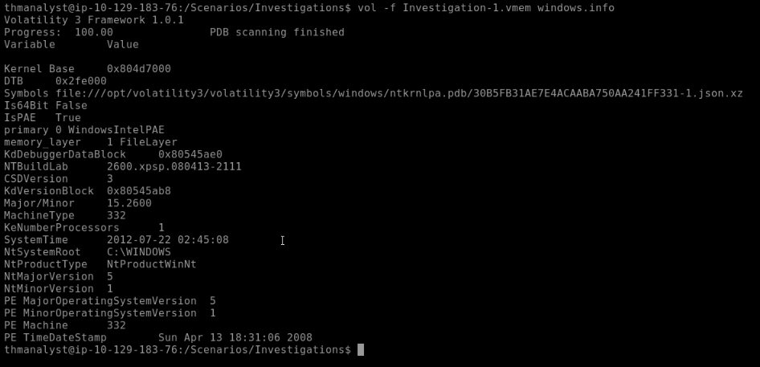
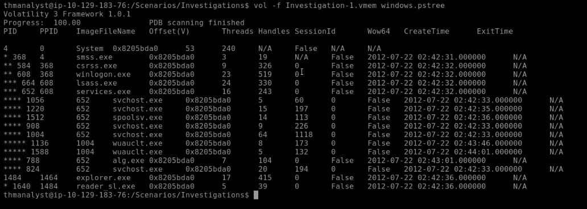
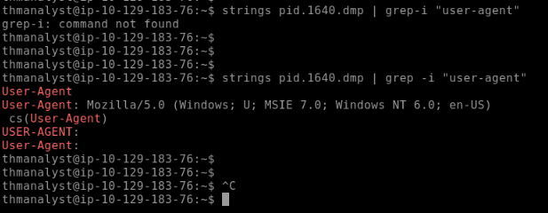
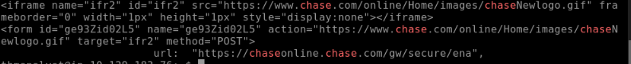
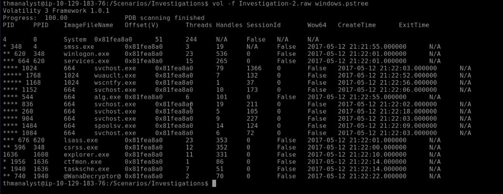
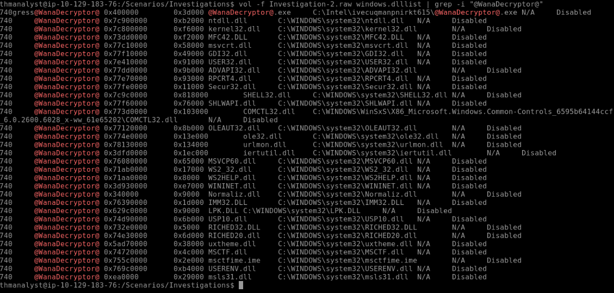
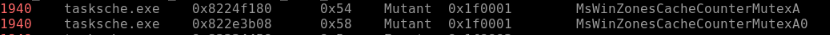

# Volatility

Volatility est un outil gratuit de forensic mémoire développé et maintenu par la Volatility Foundation, couramment utilisé par les analystes malware et SOC au sein d'une équipe blue team, ou dans le cadre de leurs solutions de détection et de surveillance. Volatility est écrit en Python et se compose de plugins et de modules Python conçus comme une approche « plug-and-play » pour analyser les dumps mémoire.

Volatility est disponible pour Windows, Linux et Mac OS, et est écrit entièrement en Python.

Volatility est le framework le plus utilisé au monde pour extraire des artefacts numériques depuis des échantillons de mémoire volatile (RAM). 
Les techniques d'extraction sont réalisées de manière totalement indépendante du système analysé, tout en offrant une visibilité sur
l'état d'exécution (runtime) du système. 

Volatility repose sur de multiples plugins qui travaillent ensemble pour obtenir
des informations depuis le dump mémoire. Pour commencer à analyser un dump, tu
dois d'abord identifier le **type d'image (image type)**.
Comme Volatility est totalement indépendant du système analysé, cela permet une
**segmentation complète** tout en donnant une **visibilité totale** sur l'état
d'exécution du système.

Au moment de la rédaction, il existe deux dépôts principaux pour Volatility : l'un
construit sur Python 2, l'autre sur Python 3.

Note : en lisant des articles de blog sur Volatility, tu pourras croiser la syntaxe
de Volatility 2. 

L'extraction d'une image mémoire peut être effectuée de différentes manières, selon les besoins de votre investigation :

| Outil | Note |
|---|---|
| **FTK Imager** | suite forensic (AccessData) ; capture RAM + imagerie disque, interface graphique |
| **Redline** | outil d'investigation de FireEye/Mandiant ; collecte et analyse mémoire |
| **DumpIt.exe** | capture rapide de la RAM en un clic (très simple, portable) |
| **win32dd.exe / win64dd.exe** | acquisition mémoire en ligne de commande (versions 32 / 64 bits) |
| **Memoryze** | outil d'acquisition et d'analyse mémoire (Mandiant) |
| **FastDump** | outil de capture mémoire (HBGary) |

L'utilisation d'un outil d'extraction sur une machine physique peut prendre beaucoup de temps.

La plupart des outils mentionnés ci-dessus génèrent un fichier au format « .raw ». Il existe toutefois des exceptions, comme Redline, qui peut utiliser son propre agent et sa propre structure de session.

Quand la cible est une VM, son fichier mémoire est directement récupérable sur
l'hôte, selon l'hyperviseur utilisé.

| Hyperviseur | Extension | Note |
|---|---|---|
| **VMware** | `.vmem` | image mémoire de la VM |
| **Hyper-V** | `.bin` | image mémoire de la VM |
| **Parallels** | `.mem` | image mémoire de la VM |
| **VirtualBox** | `.sav` | ⚠️ image mémoire **partielle** uniquement |

---

Depuis le passage à Python 3, la structure des plugins de Volatility a beaucoup
changé. Dans les versions précédentes, tu devais identifier un **profil d'OS**
correspondant exactement au système d'exploitation et à la version de build de
l'hôte — ce qui pouvait être difficile à trouver, ou donner des faux positifs avec
certains plugins. Avec Volatility 3, les profils ont été supprimés, et Volatility
**identifie automatiquement** le système et la version du fichier mémoire.

La façon de nommer les plugins a aussi changé. Dans les anciennes versions, le nom
du plugin était simplement le nom du plugin, universel pour tous les systèmes et
profils. Désormais, avec Volatility 3, tu dois **spécifier le système
d'exploitation avant** le plugin à utiliser, par exemple `windows.info` vs
`linux.info`. En effet, il n'y a plus de profils pour distinguer les systèmes, car
chaque OS a des structures et un fonctionnement mémoire radicalement différents.
Voici les préfixes d'OS disponibles :

* `.windows`
* `.linux`
* `.mac`

## Profil d'image
Par défaut, Volatility est livré avec tous les profils Windows existants, de
Windows XP à Windows 10.

Les profils d'image peuvent être difficiles à déterminer si tu ne connais pas
exactement la version et le build de la machine dont tu as extrait le dump mémoire.
Dans certains cas, on te fournit un fichier mémoire sans aucun contexte, et c'est à
toi de déterminer par où commencer. Dans ce cas, Volatility te couvre avec le
plugin `imageinfo`. Ce plugin prend le dump mémoire fourni et lui attribue une
liste des meilleurs profils d'OS possibles. Les profils d'OS ont depuis été
abandonnés (deprecated) avec Volatility 3 : nous n'aurons donc à nous soucier
d'identifier le profil que si nous utilisons Volatility 2 — ce qui simplifie
grandement l'analyse des dumps mémoire.

Note : `imageinfo` n'est pas toujours correct et peut donner des résultats variés
selon le dump fourni ; à utiliser avec prudence, et teste plusieurs profils de la
liste proposée.

Si nous cherchons quand même à obtenir des informations sur ce que fait tourner
l'hôte à partir du dump mémoire, nous pouvons utiliser les trois plugins suivants :
`windows.info`, `linux.info`, `mac.info`. Ce plugin fournit des informations sur
l'hôte à partir du dump mémoire.

Syntaxe : `python3 vol.py -f <fichier> windows.info`

## Plugins 

Cinq plugins différents dans Volatility permettent de lister (dumper) les
processus et les connexions réseau, chacun avec des techniques variées. Dans cette
tâche, nous présentons chacun d'eux ainsi que ses avantages et inconvénients face
aux techniques d'évasion utilisées par les attaquants.

La façon la plus basique de lister les processus est `pslist` ; ce plugin récupère
la liste des processus depuis la **liste doublement chaînée** (doubly-linked list)
qui suit les processus en mémoire, équivalent à la liste des processus du Task
Manager. La sortie inclut tous les processus en cours **ainsi que les processus
terminés**, avec leur heure de fin (exit time).

Syntaxe : `python3 vol.py -f <fichier> windows.pslist`

Certains malwares, typiquement les **rootkits**, tentent de cacher leurs processus
en se **détachant (unlink)** de la liste. En se retirant de cette liste, leurs
processus n'apparaissent plus avec `pslist`. Pour contrer cette technique
d'évasion, on peut utiliser `psscan` : cette méthode localise les processus en
cherchant les **structures de données correspondant à `_EPROCESS`**. Cette
technique aide contre les contre-mesures d'évasion, mais peut aussi générer des
**faux positifs**.

Syntaxe : `python3 vol.py -f <fichier> windows.psscan`

Le troisième plugin de processus, `pstree`, n'offre pas de technique spéciale
contre l'évasion comme les deux précédents ; en revanche, il liste tous les
processus **selon l'ID de leur processus parent**, en utilisant les mêmes méthodes
que `pslist`. C'est utile pour un analyste afin de reconstituer toute l'histoire
des processus et de comprendre ce qu'il se passe lors de l'extraction des données.

Syntaxe : `python3 vol.py -f <fichier> windows.pstree`

Maintenant que nous savons identifier les processus, il nous faut aussi un moyen
d'identifier les **connexions réseau** présentes au moment de l'extraction sur la
machine. `netstat` va tenter d'identifier toutes les structures mémoire possédant
une connexion réseau.

Syntaxe : `python3 vol.py -f <fichier> windows.netstat`

Cette comu ne peux mande, dans l'état actuel de Volatility 3, peut être très **instable**,
en particulier sur les anciens builds de Windows. Pour pallier cela, tu peux
utiliser d'autres outils comme **bulk_extractor** pour extraire un fichier **PCAP**
depuis le fichier mémoire. Dans certains cas, c'est préférable pour les connexions
réseau que tpas identifier avec Volatility seul.
https://tools.kali.org/forensics/bulk-extractor

Le dernier plugin que nous couvrons est `dlllist`. Il liste toutes les **DLL**
associées aux processus au moment de l'extraction. C'est particulièrement utile
une fois une analyse plus poussée effectuée : tu peux filtrer la sortie sur une DLL
spécifique qui pourrait être un indicateur d'un type précis de malware que tu
soupçonnes présent sur le système.

Syntaxe : `python3 vol.py -f <fichier> windows.dlllist`

---

Volatility propose une multitude de plugins qui peuvent aider tes capacités de
hunting et de détection lorsque tu recherches des malwares ou d'autres anomalies
dans la mémoire d'un système.

Il est recommandé d'avoir une compréhension de base de la façon dont les techniques
d'évasion et les différentes techniques de malware sont employées par les
attaquants, ainsi que de la manière de les traquer et de les détecter, avant
d'aborder cette section.

Le premier plugin, l'un des plus utiles pour chasser l'**injection de code**, est
`malfind`. Ce plugin tente d'identifier les processus injectés et leurs PID, avec
l'adresse d'offset et une vue en **Hex**, **ASCII** et **désassemblage** de la zone
infectée. Il fonctionne en scannant le **heap** et en identifiant les processus
dont le bit exécutable est positionné (`RWE` ou `RX`) et/ou qui n'ont **aucun
fichier mappé sur le disque** (malware fileless).

Selon ce que `malfind` identifie, la zone injectée varie. Un **en-tête MZ** est un
indicateur de fichier exécutable Windows. La zone injectée peut aussi pointer vers
du **shellcode**, qui nécessite une analyse plus poussée.

Syntaxe : `python3 vol.py -f <fichier> windows.malfind`

Volatility offre aussi la possibilité de comparer le fichier mémoire à des **règles
YARA**. `yarascan` recherche des chaînes, des motifs (patterns) et des règles
composées (compound rules) contre un jeu de règles. Tu peux soit passer un fichier
YARA en argument, soit lister les règles directement dans la ligne de commande.

Syntaxe : `python3 vol.py -f <fichier> windows.yarascan`

---

La forensic mémoire avancée peut devenir confuse dès qu'on parle d'objets système
et de la manière dont le malware interagit directement avec le système, surtout si
tu n'as pas d'expérience préalable dans la traque de certaines techniques comme le
**hooking** et la **manipulation de drivers**. Face à un adversaire avancé, tu peux
rencontrer des malwares — le plus souvent des **rootkits** — qui emploient des
mesures d'évasion très vicieuses, t'obligeant en tant qu'analyste à plonger dans
les **drivers**, les **mutex** et les **fonctions hookées**. Plusieurs modules
peuvent nous aider dans cette démarche pour débusquer un malware caché en mémoire.

La première technique d'évasion que nous traquons est le **hooking** ; les
attaquants emploient cinq méthodes de hooking, listées ci-dessous :

* SSDT Hooks
* IRP Hooks
* IAT Hooks
* EAT Hooks
* Inline Hooks

Nous nous concentrerons uniquement sur la traque du **SSDT hooking**, car c'est
l'une des techniques les plus courantes en matière d'évasion de malware, et le
plugin le plus simple à utiliser avec les plugins de base de Volatility.

Le plugin `ssdt` recherche le hooking et affiche ses résultats. Le hooking peut
être utilisé par des **applications légitimes** : c'est donc à toi, analyste,
d'identifier ce qui est malveillant. En bref, le SSDT hooking : `SSDT` signifie
**System Service Descriptor Table** ; le noyau Windows utilise cette table pour
retrouver les fonctions système. Un attaquant peut se « hooker » dans cette table
et modifier les pointeurs pour qu'ils pointent vers un emplacement contrôlé par le
rootkit.

Il peut y avoir des **centaines d'entrées** de table que `ssdt` va dumper ; tu
devras ensuite analyser la sortie plus en détail ou la comparer à une **baseline**
(référence saine). Il est conseillé d'utiliser ce plugin **après** avoir investigué
la compromission initiale, en t'appuyant dessus comme piste d'investigation.

Syntaxe : `python3 vol.py -f <fichier> windows.ssdt`

Les attaquants utilisent aussi des **fichiers driver malveillants** dans le cadre
de leur évasion. Volatility propose deux plugins pour lister les drivers.

Le plugin `modules` dumpe la liste des **modules noyau chargés** ; utile pour
identifier un malware actif. En revanche, si un fichier malveillant est en
**attente passive** ou **caché**, ce plugin peut le manquer. Il s'utilise au mieux
une fois que tu as déjà investigué et trouvé des indicateurs potentiels à utiliser
comme entrée de recherche et de filtrage.

Syntaxe : `python3 vol.py -f <fichier> windows.modules`

Le plugin `driverscan` scanne les **drivers présents** sur le système au moment de
l'extraction. Il peut aider à identifier des fichiers driver dans le noyau que le
plugin `modules` aurait manqués ou qui étaient cachés. Comme pour le plugin
précédent, il est recommandé d'avoir mené une investigation préalable avant de
passer à celui-ci, et de regarder la sortie de `modules` **avant** `driverscan`.

Syntaxe : `python3 vol.py -f <fichier> windows.driverscan`

Dans la plupart des cas, `driverscan` ne renvoie **aucun résultat** ; cependant, si
tu ne trouves rien avec le plugin `modules`, il peut être utile de tenter ce
plugin.

D'autres plugins, listés ci-dessous, peuvent être utiles pour traquer les malwares
avancés en mémoire :

* `modscan`
* `driverirp`
* `callbacks`
* `idt`
* `apihooks`
* `moddump`
* `handles`

## Contexte des exercices :

Cas 001 – BOB ! CE N'EST PAS UN CHEVAL !

Ton SOC t'informe qu'il a récupéré un dump mémoire depuis un endpoint mis en
quarantaine, soupçonné d'avoir été compromis par un **cheval de Troie bancaire
(banking trojan)** se faisant passer pour un document Adobe. Ton travail : utiliser
tes connaissances en threat intelligence et en reverse engineering pour réaliser
une forensic mémoire sur l'hôte infecté.

On t'a signalé une **IP suspecte** en lien avec le fichier, qui pourrait t'être
utile : `41.168.5.140`

Le fichier mémoire se trouve dans : `/Scenarios/Investigations/Investigation-1.vmem`

Cas 002 – Ça m'a un peu blessé

On t'informe que ton entreprise a été touchée par une chaîne de **ransomware** qui
frappe des entreprises à l'international. Ton équipe a déjà récupéré la **clé de
déchiffrement** et s'est remise de l'attaque. Néanmoins, ton travail est de réaliser
une **analyse post-incident** et d'identifier quels acteurs étaient en jeu et ce
qui s'est passé sur tes systèmes. Ton équipe te fournit un dump mémoire brut (raw)
pour commencer ton analyse.

Le fichier mémoire se trouve dans : `/Scenarios/Investigations/Investigation-2.raw`

### Question :

1 - Quelle est la version de build de la machine hôte dans le cas 001 ?

On utilise la commande : vol -f Investigation-1.vmem windows.info



réponse : 2600.xpsp.080413-2111

2 - À quel moment le fichier mémoire a-t-il été acquis dans le dossier 001 ?

On regarde la ligne "SystemTime".

réponse : 2012-07-22 02:45:08

3 - Quel processus peut être considéré comme suspect dans le cas 001 ?

On utilise la commande : vol -f Investigation-1.vmem windows.pstree



On observe que reader_sl.exe a été lancé depuis explorer.exe

réponse : reader_sl.exe

4 - Quel est le processus parent du processus suspect dans le cas 001 ?

réponse : explorer.exe

5 - Quel est le PID du processus suspect dans le cas 001 ?

réponse : 1640

6 - Quel est le PID du processus parent dans le cas 001 ?

réponse : 1484

7 - Quel agent utilisateur a été utilisé par l’adversaire dans le cas 001 ?

J'ai utilisé les indices pour répondre à la question :

1. Le dump mémoire du processus

vol -f Investigation-1.vmem -o /home/user windows.memmap.Memmap --pid 1640 --dump

J'ai extrait toute la mémoire du processus 1640 (le processus suspect) depuis le dump global, et je l'ai  écrite dans un fichier : pid.1640.dmp.

Analogie : le .vmem c’est la photo de toute la RAM de la machine. Là, tu as découpé juste la part qui appartient au processus 1640 pour l’étudier isolément. Ce .dmp contient tout ce que ce processus avait en mémoire : son code, ses données, les chaînes de caractères qu’il manipulait (URL, chemins, commandes…).

2. La recherche du user-agent

strings pid.1640.dmp | grep -i "user-agent"

strings sort des milliers de lignes. Le | grep filtre pour ne garder que celles contenant « user-agent » (le -i = insensible à la casse, donc il attrape aussi User-Agent, USER-AGENT…).

Autre exemple qui pourrait servir dans d'autres exercices :

# Recherche d'IOC dans un dump mémoire (strings + grep)

Après avoir dumpé la mémoire d'un processus suspect :
`vol -f dump.vmem -o /home/user windows.memmap.Memmap --pid <PID> --dump`
→ on obtient `pid.<PID>.dmp`, qu'on fouille avec `strings | grep`.

## Réseau

```bash
# URL / liens HTTP
strings pid.1640.dmp | grep -iE "http://|https://"

# Adresses IP (format x.x.x.x)
strings pid.1640.dmp | grep -E "([0-9]{1,3}\.){3}[0-9]{1,3}"

# Noms de domaine
strings pid.1640.dmp | grep -iE "\.com|\.net|\.xyz|\.ru|\.top"

# En-têtes HTTP (communication C2)
strings pid.1640.dmp | grep -iE "user-agent|host:|cookie:|referer|POST|GET"
```

## Système et exécution

```bash
# Chemins de fichiers Windows
strings pid.1640.dmp | grep -iE "C:\\\\|\.exe|\.dll|\.bat|\.ps1"

# Clés de registre (persistance)
strings pid.1640.dmp | grep -iE "HKLM|HKCU|CurrentVersion\\\\Run|Software\\\\Microsoft"

# Commandes / outils suspects
strings pid.1640.dmp | grep -iE "powershell|cmd.exe|wscript|rundll32|regsvr32|certutil"

# Dossiers temp (dépôt fréquent de malware)
strings pid.1640.dmp | grep -iE "Temp|AppData|ProgramData|Downloads"
```

## Identifiants / données sensibles

```bash
# Adresses e-mail
strings pid.1640.dmp | grep -iE "[a-z0-9._%+-]+@[a-z0-9.-]+\.[a-z]{2,}"

# Mots-clés d'authentification
strings pid.1640.dmp | grep -iE "password|passwd|login|username|token|apikey"
```

## Spécifique malware

```bash
# Encodage (base64 planqué = souvent du payload)
strings pid.1640.dmp | grep -iE "base64|FromBase64|-enc|-EncodedCommand"

# Ransomware : notes de rançon, cryptomonnaie
strings pid.1640.dmp | grep -iE "bitcoin|wallet|ransom|decrypt|\.onion"

# Mutex (évite la double exécution d'un malware)
strings pid.1640.dmp | grep -iE "mutex|Global\\\\"
```

## Astuces de syntaxe

```bash
# Combiner plusieurs termes (| = OU dans une regex)
strings pid.1640.dmp | grep -iE "http|\.exe|powershell|password"

# Contexte autour de la ligne trouvée
strings pid.1640.dmp | grep -i "user-agent" -A 3 -B 3
# -A 3 = 3 lignes après | -B 3 = 3 lignes avant
```

## Logique

| Tu cherches… | Pour prouver… |
|---|---|
| URL / IP / domaine | communication avec un C2 |
| User-Agent | empreinte réseau du malware |
| chemins .exe / Temp | où le malware s'est déposé |
| clés Run du registre | la persistance |
| powershell / certutil / base64 | la technique d'exécution |
| bitcoin / .onion / ransom | un ransomware |




réponse : Mozilla/5.0 (Windows; U; MSIE 7.0; Windows NT 6.0; en-US)

8 - Chase Bank figurait-elle parmi les domaines bancaires suspects identifiés dans le dossier 001 ? (Oui/Non)

On utilise la commande : strings pid.1640.dmp | grep -i "chase" 



réponse : Y

9 - Quel processus suspect est en cours d'exécution avec le PID 740 dans le cas 002 ?

On utilise la commande : vol -f Investigation-2.raw windows.pstree



On peut voir un processus @WanaDecryptor@ lacé par tasksche.exe

réponse : @WanaDecryptor@

10 - Quel est le chemin complet du binaire suspect associé au PID 740 dans le dossier 002 ?

Je reproduis ce que j'ai fais pour la partie 1 :

1ere commande : vol -f Investigation-2.raw -o /home/thmanalyst/ windows.memmap.Memmap --pid 740 --dump
2eme commande : strings pid.740.dmp | grep -i "@Wana"


réponse : C:\Intel\ivecuqmanpnirkt615\@WanaDecryptor@.exe

11 - Quel est le processus parent du PID 740 dans le cas 002 ?

réponse : tasksche.exe

12 - Quel est le PID du processus parent suspect lié au déchiffreur dans le cas 002 ?

réponse : 1940

13 - D’après les informations dont nous disposons actuellement, quel logiciel malveillant est présent sur le système dans le cadre du dossier 002 ?

WanaDecryptor => Ransomware Wannacry. 

réponse : WannaCry

14 - Quelle DLL est chargée par le déchiffreur utilisé pour la création de sockets dans le cas 002 ?

On utilise la commande vol -f Investigation-2.raw windows.dlllist | grep -i "@WanaDecryptor@"



En faisait des recherches, la dll qui sert à crée des sockets est WS2_32.dll

15 - Quel mutex peut être identifié comme un indicateur connu du logiciel malveillant en question dans le cas 002 ?

Mutex ( mutant) : l'idée de base

Imagine une clé unique pour des toilettes : quand quelqu'un entre, il prend la clé,
et tant qu'il ne l'a pas rendue, personne d'autre ne peut entrer. Le mutex, c'est
ça : un **verrou nommé** que les programmes se passent pour ne pas se marcher dessus.

Techniquement, en programmation classique, ça évite que **deux threads** modifient
la même donnée en même temps (ce qui corromprait les données). Un thread « prend »
le mutex, fait son travail, puis le « relâche ».

Beaucoup de malwares créent un **mutex nommé** au démarrage, mais pour une autre raison : **éviter de d'infecter deux fois**
la même machine.

Le malware fonctionne comme ça :

1. Au lancement, il vérifie : « est-ce qu'un mutex nommé `XYZ` existe déjà ? »
2. S'il existe → une copie de moi tourne déjà → je m'arrête.
3. S'il n'existe pas → je le crée, et je continue mon infection.

Ça lui évite des bugs, des plantages ou d'attirer l'attention en tournant en double.

Le nom du mutex devient un **IOC** (indicateur de compromission) précieux :

* il est souvent **codé en dur** et **unique** à une famille de malware → il sert
  de signature. Exemple célèbre : WannaCry utilisait le mutex
  `MsWinZonesCacheCounterMutexA`.
* tu peux **chasser** d'autres machines infectées en cherchant ce même mutex.
* certains outils de défense « vaccinent » une machine en créant le mutex à
  l'avance → le malware croit qu'il est déjà installé et ne s'exécute pas.

On utilise la commande : vol -f Investigation-2.raw windows.handles | grep 1940



16 - Quel plugin pourrait être utilisé pour identifier tous les fichiers chargés depuis le répertoire de travail du logiciel malveillant dans le cas 002 ?

Apres des recherches sur l'outil on peut utiliser windows.filescan


