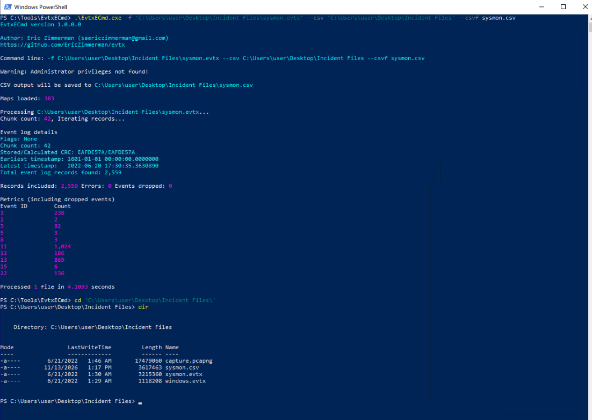
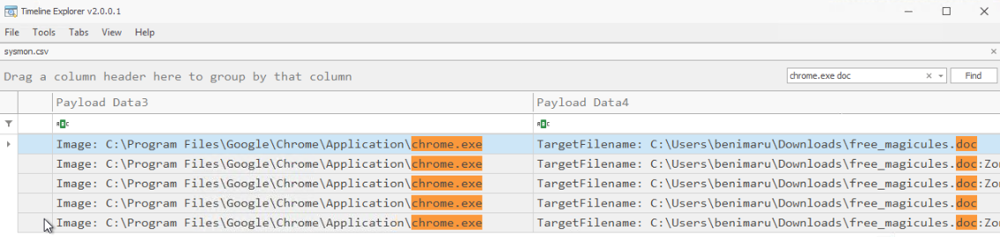

# Incident Tempest

Dans cet incident, vous jouez le rôle d'un **Incident Responder** suite à une alerte triée par l'un des analystes de votre SOC. L'analyste a confirmé que l'alerte est de sévérité **CRITICAL** et qu'elle nécessite une investigation approfondie.

D'après l'analyste SOC, l'intrusion a commencé par un **document malveillant**. Il a aussi rassemblé les informations essentielles générées par l'alerte :

- Le document malveillant a une extension **`.doc`**.
- L'utilisateur a téléchargé le document malveillant via **`chrome.exe`**.
- Le document malveillant a ensuite exécuté une **chaîne de commandes** pour obtenir l'exécution de code.

## Guide d'investigation

Pour vous aider, vous pouvez vous appuyer sur l'aide-mémoire rédigé par l'équipe pour ce scénario :

- Commencez par les événements générés par **Sysmon**.
- **EvtxECmd**, **Timeline Explorer** et **SysmonView** permettent d'interpréter les logs Sysmon.
- Suivez les **processus enfants de `WinWord.exe`**.
- Utilisez des filtres comme **`ParentProcessID`** ou **`ProcessID`** pour établir la relation entre les processus.
- Concentrez-vous sur les événements Sysmon suivants pour corréler l'activité générée par le document malveillant :
  - **Event ID 1** : création de processus (Process Creation)
  - **Event ID 22** : requêtes DNS (DNS Query)

---

### Question :

1 - L'utilisateur de cette machine a été compromis par un document malveillant. Quel est le nom de fichier du document ?

Pour l’analyse, on exporte d’abord le journal .evtx en CSV avec l'outil EvtxECmd.

On met un flitre sur chrome.exe et .doc

reponse : free_magicules.doc
  
