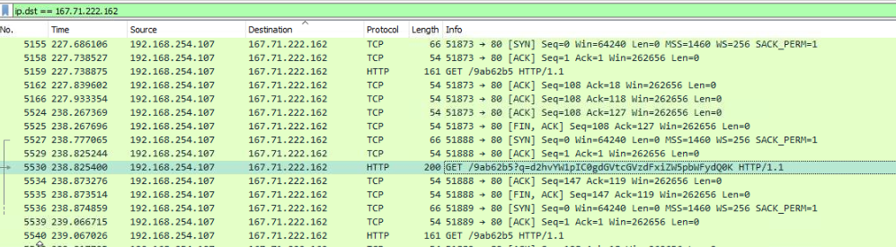
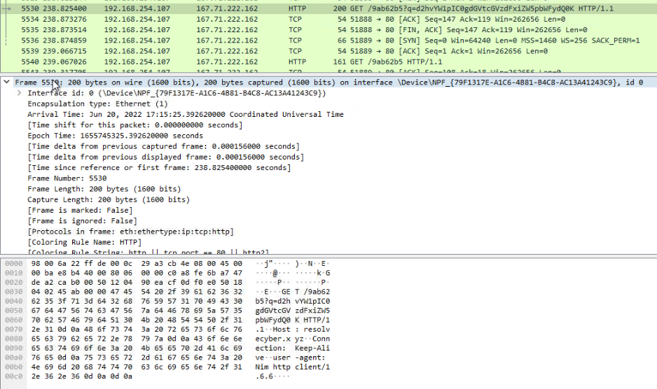

# Trafic réseau du document malveillant

D'après les éléments collectés, on a découvert que l'attaquant a **récupéré le payload de stage 2 à distance** :

- On a trouvé dans les logs Sysmon le **domaine et l'IP** contactés par le document malveillant.
- Un **autre domaine et une autre IP**, utilisés par le payload de stage 2, apparaissent dans la même source de données.

## Guide d'investigation

Comme on a découvert des artefacts réseau, on peut de nouveau se référer à l'aide-mémoire, cette fois axé sur l'**analyse des logs réseau** :

- On peut maintenant utiliser **Brim** et **Wireshark** pour analyser la capture de paquets.
- Recherchez les événements réseau liés aux **domaines et adresses IP collectés**.
- Exemple de filtre Brim utilisable pour cette investigation :

```
_path=="http" "<domaine malveillant>"
```
### Question :

1 - Quelle est l'URL de la charge utile malveillante intégrée au document ? Format : URL complète, incluant http://

On utilise la requête dans Brim : _path=="http" "<domaine malveillant>". Le domaine malveillant est phishteam.xyz.
La commande est donc : _path=="http" "phishteam.xyz". On regarde ensuite la colonne "uri"


réponse : http://phishteam.xyz/02dcf07/index.html

2 - Quel est l'encodage utilisé par l'attaquant sur la connexion C2 ?

Le serveur C2 a pour adresse IP 167.71.122.162.


On peut retrouver une chaine en base64.

3 - Le binaire malveillant de type C2 envoie une charge utile via un paramètre qui contient les résultats de la commande exécutée. Quel est le paramètre utilisé par ce binaire ?

En observant la trame dans Wireshark, on observe que chaque commande encodé en base64 commence par le paramétré q=.

4 - Le binaire malveillant de type C2 se connecte à une URL spécifique pour récupérer la commande à exécuter. Quelle est l'URL utilisée par ce binaire ?



réponse : /9ab62b5

5 - Quelle est la méthode HTTP utilisée par le binaire ?

Il s'agit de requête GET.

D'après l'agent utilisateur, quel langage de programmation l'attaquant a-t-il utilisé pour compiler le binaire ?



réponse : il s'agit du user agent nim.


