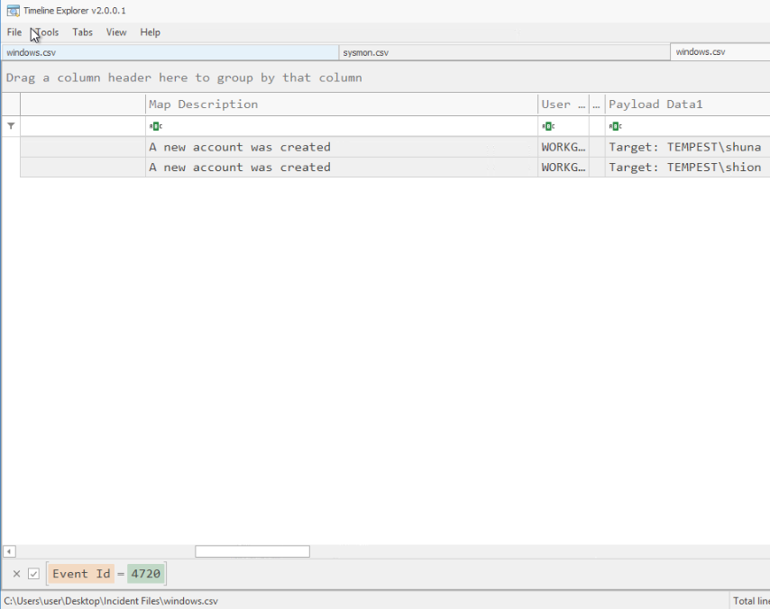
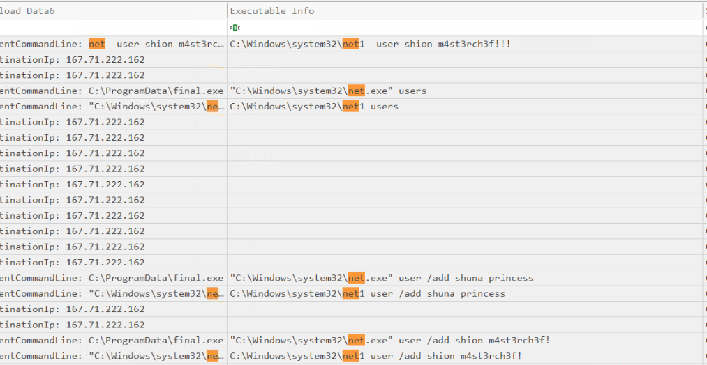
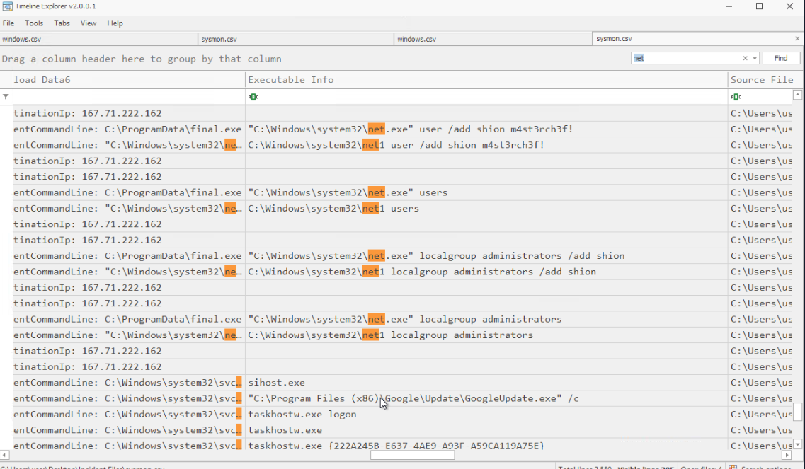
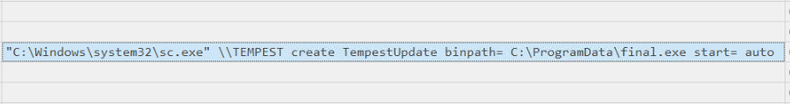

# Machine totalement compromise (Fully-Owned Machine)

L'attaquant a désormais obtenu les privilèges administrateur sur la machine. Il faut identifier toutes les techniques de persistance utilisées par l'attaquant.

Par ailleurs, les exécutions inhabituelles sont liées au binaire C2 malveillant utilisé lors de l'élévation de privilèges.

## Guide d'investigation

On peut maintenant s'appuyer sur notre cheatsheet pour investiguer les événements qui suivent une élévation de privilèges réussie :

* Filtre Brim utile pour récupérer toutes les requêtes HTTP liées au trafic C2 malveillant : `_path=="http" "<remplacer domaine>" id.resp_p==<remplacer port> | cut ts, host, id.resp_p, uri | sort ts`
* L'attaquant a obtenu les privilèges SYSTEM ; désormais, le contexte utilisateur de chaque exécution malveillante se fond dans `NT Authority\System`.
* Tous les événements enfants (child events) du nouveau binaire malveillant utilisé pour le C2 méritent d'être examinés.

### Question :

1 - Après avoir obtenu un accès de niveau SYSTEM, l'attaquant a créé deux utilisateurs. Quels sont les noms de ces comptes ? 
Format : Réponse par ordre alphabétique, séparée par des virgules

On sait que la création d'un utilisateur déclenche un event 4720. On utilise donc un filtre sur cet event :

réponse : shion,shuna

2 - Avant de réussir à créer les comptes, l'attaquant a exécuté des commandes qui ont échoué. Quelle est l'option manquante qui est à l'origine de cet échec ?

On peut voir 2 tentatives de création d'un même utilisateur sauf que sur le deuxième essaie, l'option /add est ajouté.

réponse : /add

3 - D’après les journaux d’événements Windows, les comptes ont été créés avec succès. Quel est l’identifiant d’événement (ID d’événement) qui indique l’activité de création de compte ?

Expliqué dans la question 1, l'event ID qui indique la création d'un compte utilisateur est 4720.

4 - L'attaquant a ajouté l'un des comptes au groupe des administrateurs locaux. Quelle commande l'attaquant a-t-il utilisée ?

réponse : net localgroup administrators /add shion

5 - D'après les journaux d'événements Windows, le compte a été ajouté avec succès à un groupe sensible. Quel est l'identifiant d'événement (ID d'événement) qui indique l'ajout à un groupe local sensible ?

Dans les logs sysmon, la commande à été exécuté à cette date 2022-06-20 17:27:41.
On regarde dans les logs du poste à la même heure et on obtient l’évent 4732.

réponse : 4732

6 - Après la création du compte, l'attaquant a mis en œuvre une technique visant à établir un accès administratif persistant. Quelle est la commande exécutée par l'attaquant pour y parvenir ?

En descendant les logs, on retrouve cette commande :

réponse : C:\Windows\system32\sc.exe \\TEMPEST create TempestUpdate2 binpath= C:\ProgramData\final.exe start= auto

