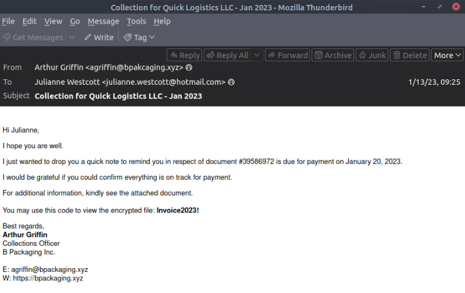
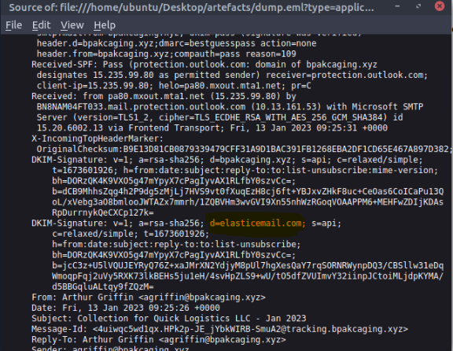
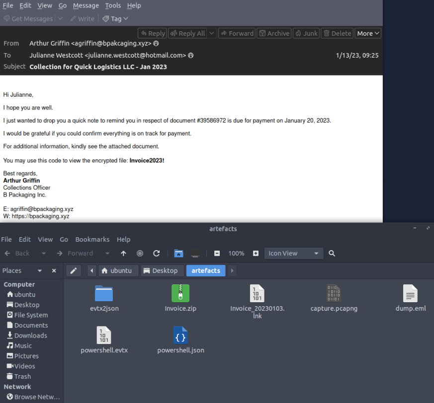

# Le Boogeyman est là !

Julianne, employée du service financier de Quick Logistics LLC, reçoit un e-mail de relance concernant une facture impayée de la part de son partenaire commercial, B Packaging Inc. À son insu, le document joint est malveillant et compromet son poste de travail.

L'équipe sécurité a réussi à repérer l'exécution suspecte de la pièce jointe. Ajouté aux signalements de phishing remontés par les autres employés du service financier, cela laisse penser à une attaque ciblée contre l'équipe finance. En consultant les dernières tendances, la TTP initiale utilisée pour la pièce jointe malveillante est attribuée à un nouveau groupe malveillant nommé **Boogeyman**, connu pour cibler le secteur de la logistique.

Tu es chargé d'analyser et d'évaluer l'impact de la compromission.

## Guide d'investigation

D'après les informations initiales, on sait que la compromission a démarré par un e-mail de phishing. Commençons par analyser le fichier `dump.eml` situé dans le répertoire des artefacts. Il y a deux façons d'analyser les en-têtes et de reconstruire la pièce jointe :

* **La méthode manuelle**, à l'aide d'outils en ligne de commande comme `cat`, `grep`, `base64` et `sed`. Analyse le contenu manuellement et reconstruis la pièce jointe en décodant la chaîne située en bas du fichier.

```shell-session
ubuntu@tryhackme$ echo # exemple de commande pour reconstruire le payload, en supposant que le payload encodé a été écrit dans un autre fichier, sans les caractères de fin de ligne
ubuntu@tryhackme$ cat *FICHIER PAYLOAD* | base64 -d > Invoice.zip
```

* **Une méthode alternative et plus simple** : double-clique sur le fichier EML pour l'ouvrir via Thunderbird. La pièce jointe peut alors être sauvegardée et extraite normalement.

Une fois le payload extrait de l'archive chiffrée, utilise `lnkparse` pour extraire les informations contenues dans le payload.

```shell-session
ubuntu@tryhackme$ lnkparse *FICHIER LNK*
```
### Question : 

1 - Quelle est l’adresse e-mail utilisée pour envoyer l’e-mail de hameçonnage ?

On ouvre le mail sur le client Thunderbird :



L'adresse utilisé pour envoyer le mail est agriffin@bpakcaging.xyz

2 - Quelle est l’adresse e-mail de la victime ?

L'adresse de la victime est julianne.westcott@hotmail.com

3 - Quel est le nom du service de relais de messagerie tiers utilisé par l'attaquant, d'après les en-têtes « DKIM » et « List-Unsubscribe » ?

On regarde l’entête du mail. Après vérification, elasticemail est bien un service de relais de messagerie :



4 - Quel est le nom du fichier contenu dans la pièce jointe chiffrée ?

On récupérè le fichier Invoice_20230103.lnk dans la pièce jointe du mail.



5 - Quel est le mot de passe de la pièce jointe chiffrée ?

Le mot de passe est écrit dans le mail : Invoice2023!

6 - D'après le résultat de l'outil lnkparse, quelle est la charge utile encodée présente dans le champ « Command Line Arguments » ?


