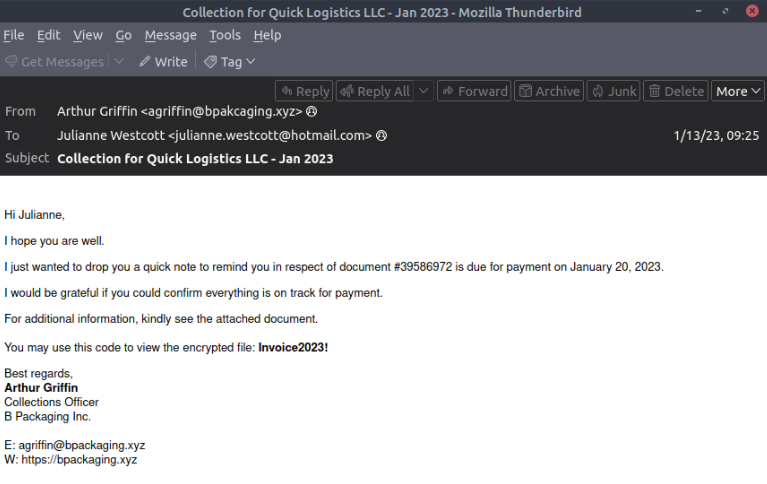

# Boogeyman 1

D'après les premières constatations, on a découvert comment la pièce jointe malveillante a compromis le poste de Julianne :

* Une commande PowerShell a été exécutée.
* Le décodage du payload révèle le point de départ de l'activité sur l'endpoint.

## Guide d'investigation

Avec ces découvertes, on peut maintenant passer à l'analyse des logs PowerShell pour mesurer l'impact potentiel de l'attaque :

* En s'appuyant sur les constatations précédentes, on commence l'analyse en recherchant l'exécution du payload initial dans les logs PowerShell.
* Les données étant au format JSON, on peut les parser en ligne de commande avec la commande `jq`.
* Note : certains logs sont redondants et ne contiennent aucune information critique ; ils peuvent donc être ignorés.

## Cheatsheet jq

`jq` est un processeur JSON léger et flexible en ligne de commande. Il peut s'utiliser en combinaison avec d'autres commandes de traitement de texte.

Tu peux t'appuyer sur le tableau suivant pour parser les logs de cette tâche.

| Objectif | Commande |
|---|---|
| Parser tout le JSON en sortie lisible (beautified) | `cat powershell.json \| jq` |
| Afficher toutes les valeurs d'un champ précis, sans afficher le nom du champ | `cat powershell.json \| jq '.Field1'` |
| Afficher toutes les valeurs d'un champ précis | `cat powershell.json \| jq '{Field1}'` |
| Afficher les valeurs de plusieurs champs | `cat powershell.json \| jq '{Field1, Field2}'` |
| Trier les logs selon leur Timestamp | `cat powershell.json \| jq -s -c 'sort_by(.Timestamp) \| .[]'` |
| Trier les logs selon leur Timestamp et afficher plusieurs champs | `cat powershell.json \| jq -s -c 'sort_by(.Timestamp) \| .[] \| {Field}'` |

### Question :

1 - Quels sont les domaines utilisés par l'attaquant pour l'hébergement de fichiers et le C2 ? Indiquez les domaines par ordre alphabétique. (ex. : a.domain.com, b.domain.com)

