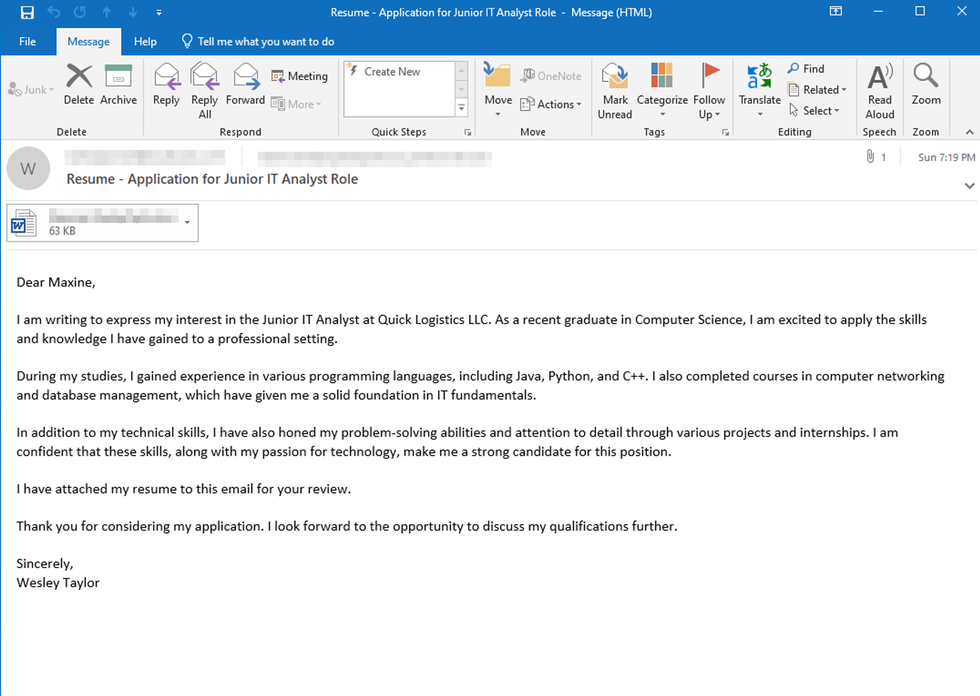
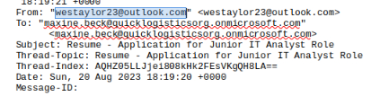

# Le Boogeyman est de retour !

Maxine, spécialiste des ressources humaines chez Quick Logistics LLC, reçoit une candidature pour l'un des postes ouverts dans l'entreprise. À son insu, le CV joint est malveillant et compromet son poste de travail.

L'équipe sécurité a réussi à repérer des commandes suspectes exécutées sur le poste de Maxine, ce qui a déclenché l'investigation. Dans ce contexte, tu es chargé d'analyser et d'évaluer l'impact de la compromission.

 

### Question :

1 - Quelle adresse e-mail a été utilisée pour envoyer l'e-mail de hameçonnage ?

On regarde l’entête du mail : 

 

réponse : westaylor23@outlook.com

2 - Quelle est l'adresse e-mail de l'employé victime ?

On suit l’entête :

réponse : maxine.beck@quicklogisticsorg.onmicrosoft.com

3 - Quel est le nom du document malveillant joint ?

4 - Quel est le hash MD5 de la pièce jointe malveillante ?

5 - Quelle URL est utilisée pour télécharger la charge utile (payload) de la deuxième étape, via la macro présente dans le document ?
