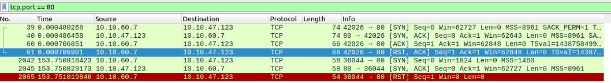
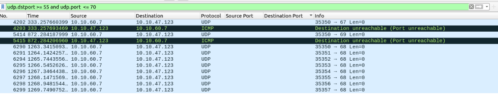

# Détecter les scans Nmap avec Wireshark

Nmap est l'outil de référence pour cartographier un réseau : il découvre les hôtes actifs et les services exposés. Un analyste SOC doit savoir **reconnaître les motifs réseau** qu'il génère. Ce cours couvre les trois types de scans les plus courants :

- **TCP Connect** (`-sT`)
- **SYN** (`-sS`)
- **UDP** (`-sU`)

---

## 1. Rappel : les flags TCP

Chaque flag TCP correspond à un bit, et `tcp.flags` est la **somme** des bits activés :

| Flag | Valeur |
|---|---|
| FIN | 1 |
| SYN | 2 |
| RST | 4 |
| PSH | 8 |
| ACK | 16 |

→ SYN+ACK = 2 + 16 = **18**, RST+ACK = 4 + 16 = **20**.

## Deux façons de filtrer

| Objectif | Filtre **strict** (uniquement ces flags) | Filtre **souple** (ce flag est présent, les autres sont libres) |
|---|---|---|
| SYN | `tcp.flags == 2` | `tcp.flags.syn == 1` |
| ACK | `tcp.flags == 16` | `tcp.flags.ack == 1` |
| SYN, ACK | `tcp.flags == 18` | `tcp.flags.syn == 1 and tcp.flags.ack == 1` |
| RST | `tcp.flags == 4` | `tcp.flags.reset == 1` |
| RST, ACK | `tcp.flags == 20` | `tcp.flags.reset == 1 and tcp.flags.ack == 1` |
| FIN | `tcp.flags == 1` | `tcp.flags.fin == 1` |

Recherche globale : `tcp` / `udp`

---

## 2. TCP Connect Scan (`nmap -sT`)

**Principe :** Nmap demande au système d'exploitation d'établir une **connexion TCP complète** (three-way handshake).

- C'est le **seul type de scan TCP possible sans droits root**, donc utilisé par les utilisateurs non privilégiés.
- **Taille de fenêtre généralement > 1024 octets** : c'est une vraie connexion, qui s'attend à recevoir des données.

## Motifs

| Port ouvert | Port fermé |
|---|---|
| `SYN →` | `SYN →` |
| `← SYN, ACK` | `← RST, ACK` |
| `ACK →` | |
| `RST, ACK →` (Nmap ferme la connexion) | |

## Filtre de détection

```
tcp.flags.syn==1 and tcp.flags.ack==0 and tcp.window_size > 1024
```

---

## 3. SYN Scan (`nmap -sS`) – « half-open » ou « stealth »

**Principe :** Nmap envoie un SYN, lit la réponse, puis **coupe avant de finir le handshake**.

- **Nécessite des droits root/admin**, car Nmap forge lui-même les paquets.
- C'est le **scan par défaut** de Nmap quand il est lancé avec des privilèges.
- **Taille de fenêtre généralement ≤ 1024 octets** : la connexion ne va pas jusqu'au bout et n'attend aucune donnée.

## Motifs

| Port ouvert | Port fermé |
|---|---|
| `SYN →` | `SYN →` |
| `← SYN, ACK` | `← RST, ACK` |
| `RST →` (Nmap coupe tout de suite) | |

## Filtre de détection

```
tcp.flags.syn==1 and tcp.flags.ack==0 and tcp.window_size <= 1024
```

## Connect vs SYN : comment les distinguer

| | TCP Connect (`-sT`) | SYN (`-sS`) |
|---|---|---|
| Handshake complet | ✅ Oui | ❌ Non |
| Droits requis | Utilisateur standard | Root / admin |
| Réponse du scanner à un SYN, ACK | `ACK` puis `RST, ACK` | `RST` directement |
| Taille de fenêtre du SYN | **> 1024** | **≤ 1024** |

**Le point clé :** dans les deux cas, on filtre les **SYN sans ACK** (premiers paquets de connexion). C'est la **taille de fenêtre** qui permet ensuite de distinguer les deux types de scans.

---

## 4. UDP Scan (`nmap -sU`)

**Principe :** UDP n'a **pas de handshake**. Nmap envoie un paquet et observe s'il reçoit une réponse.

- **Port ouvert** : en général **aucune réponse**.
- **Port fermé** : la cible renvoie un **ICMP Type 3, Code 3** (*Destination unreachable – Port unreachable*).

## Motifs

| Port ouvert | Port fermé |
|---|---|
| `UDP →` | `UDP →` |
| *(silence)* | `← ICMP Type 3, Code 3` |

## Filtre de détection

```
icmp.type==3 and icmp.code==3
```

## Astuce : retrouver le port concerné

Un message ICMP d'erreur **encapsule la requête d'origine**. Dans le panneau de détails du paquet ICMP, déplie la section ICMP : tu y trouveras l'en-tête IP et UDP de la requête initiale, avec le **port de destination** qui a été jugé fermé.

---

## 5. Mémo de détection

| Scan | Commande | Filtre Wireshark |
|---|---|---|
| TCP Connect | `nmap -sT` | `tcp.flags.syn==1 and tcp.flags.ack==0 and tcp.window_size > 1024` |
| SYN | `nmap -sS` | `tcp.flags.syn==1 and tcp.flags.ack==0 and tcp.window_size <= 1024` |
| UDP | `nmap -sU` | `icmp.type==3 and icmp.code==3` |

## Méthode d'analyse

1. Appliquer le **filtre générique** pour repérer l'anomalie : beaucoup de SYN ou d'ICMP vers de nombreux ports depuis **une même source**.
2. **Identifier l'IP du scanner** et la cible (`Statistics > Conversations` aide beaucoup).
3. **Zoomer** sur un port précis pour confirmer le motif (ouvert ou fermé).
4. Pour UDP, **lire la requête encapsulée** dans l'ICMP pour connaître le port.

## ⚠️ Limites à garder en tête

- La règle des **1024 octets est une heuristique**, pas une vérité absolue : des options Nmap ou certains OS peuvent la fausser.
- Un port UDP **sans réponse** n'est pas forcément ouvert : il peut aussi être **filtré** par un firewall. Nmap le marque alors `open|filtered`.
- Le signal le plus fiable reste le **volume** : une seule source qui contacte **beaucoup de ports différents en peu de temps**.

### Questions :

1 - Quel est le nombre total de scans « TCP Connect » ?

J'utilise la commande tcp.flags.syn==1 and tcp.flags.ack==0 and tcp.window_size > 1024

réponse : 1000

2 - Quel type de scan est utilisé pour scanner le port TCP 80 ?

J'utilise la commande tcp.port == 80 :

 

On observe un SYN, SYN ACK, ACK donc il s'agit d'un scan TCP Connect 

3 - Combien y a-t-il de messages « UDP close port » ?

J'utilise la commande icmp.type==3 and icmp.code==3

réponse : 1083

4 - Quel port UDP, compris dans la plage 55-70, est ouvert ?

J'utilise un filtre pour obtenir la liste des ports de destination entre 55 et 70 avec udp.dstport >= 50 and udp.port  <= 70

 

On observe que le port 67 et 69 renvoient "Destination Unreachable" ce qui signifie que les ports ne sont pas disponibles.

réponse : 68


