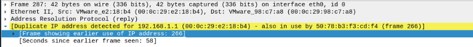
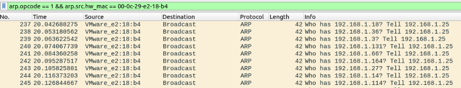

# Détecter l'ARP Poisoning / Spoofing (Man-in-the-Middle) avec Wireshark

L'**ARP** (*Address Resolution Protocol*) fait la correspondance entre une **adresse IP** et une **adresse MAC** sur un réseau local. L'**ARP Poisoning** (ou ARP Spoofing) consiste à envoyer de **fausses réponses ARP** pour corrompre la table « IP ↔ MAC » des machines. L'attaquant se fait passer pour une autre machine, le plus souvent la **passerelle**, et le trafic de la victime passe alors par lui : c'est une attaque **Man-in-the-Middle (MITM)**.

Les outils d'attaque varient, mais la **logique reste toujours la même**. Elle est donc facile à repérer si l'on connaît le fonctionnement d'ARP.

---

## 1. ARP en bref

| Caractéristique | Conséquence pour la sécurité |
|---|---|
| Fonctionne **uniquement en réseau local** (couche 2) | L'attaquant doit être sur le même LAN |
| **Non routable** | L'attaque reste confinée au segment réseau |
| **Aucune authentification** | N'importe qui peut prétendre posséder n'importe quelle IP |
| **Protocole sans état** | Une machine accepte une réponse ARP même sans l'avoir demandée |
| Motifs courants : requête / réponse, annonce, **gratuitous ARP** | Le gratuitous ARP est le vecteur classique du poisoning |

### Fonctionnement normal

1. **Requête** (broadcast) : *« Qui a l'IP 192.168.1.1 ? Répondez à 192.168.1.12 »*
2. **Réponse** (unicast) : *« 192.168.1.1 est à l'adresse 50:78:b3:f3:cd:f4 »*

---

## 2. Filtres Wireshark

| Objectif | Filtre |
|---|---|
| Tout le trafic ARP | `arp` |
| Requêtes ARP (opcode 1) | `arp.opcode == 1` |
| Réponses ARP (opcode 2) | `arp.opcode == 2` |
| **Hunt :** scan ARP | `arp.dst.hw_mac == 00:00:00:00:00:00` |
| **Hunt :** possible ARP poisoning | `arp.duplicate-address-detected or arp.duplicate-address-frame` |
| **Hunt :** possible ARP flooding depuis une MAC | `arp.opcode == 1 and arp.src.hw_mac == <mac-suspecte>` |

**Pourquoi `00:00:00:00:00:00` révèle un scan ?** Dans une requête ARP, la MAC cible est inconnue et vaut donc zéro. Une machine qui envoie **un très grand nombre** de ces requêtes vers une plage d'IP est en train de cartographier le réseau.

---

## 3. Signaux d'alerte

1. **Conflit d'adresse** : deux MAC différentes revendiquent la **même IP**. Wireshark le signale dans **Analyze > Expert Information** (« duplicate IP address »).
   ⚠️ Wireshark ne signale que la **seconde** occurrence. C'est à l'analyste de déterminer laquelle des deux est légitime.
2. **Une même MAC qui revendique plusieurs IP**, en particulier celle de la **passerelle**.
3. **Flood de requêtes ARP** depuis une seule MAC vers une plage d'IP (scan / reconnaissance).
4. **Trafic applicatif (HTTP, DNS…) dont la MAC de destination ne correspond pas à la machine attendue.**

---

## 4. Méthode d'investigation (cas du cours)

### Étape 1 – Repérer le conflit

La MAC `00:0c:29:e2:18:b4` (« b4 ») envoie des requêtes avec l'IP `192.168.1.25`, puis **prétend posséder `192.168.1.1`**, l'adresse probable de la passerelle, déjà revendiquée par `50:78:b3:f3:cd:f4`.

### Étape 2 – Repérer le flood

La même MAC « b4 » envoie **une multitude de requêtes ARP** vers toute la plage `192.168.1.x` : c'est une reconnaissance du réseau.

### Étape 3 – Corréler avec les autres protocoles

Le trafic HTTP paraît normal **au niveau IP**. Il faut **ajouter les colonnes MAC** dans la liste des paquets :
> Clic droit sur `Ethernet II > Source` / `Destination` dans les détails du paquet → **Apply as Column**

On voit alors que **tous les paquets HTTP de la victime partent vers la MAC « b4 »** au lieu de la passerelle. Le MITM est confirmé.

**Leçon clé :** avec un ARP spoofing, les **IP restent cohérentes** et **seule la couche MAC trahit l'attaque**. Il faut donc toujours afficher les adresses MAC.

### Étape 4 – Synthèse des rôles

| Rôle | MAC | IP |
|---|---|---|
| **Attaquant** | `00:0c:29:e2:18:b4` | `192.168.1.25` |
| **Passerelle / routeur** | `50:78:b3:f3:cd:f4` | `192.168.1.1` |
| **Victime** | `00:0c:29:98:c7:a8` | `192.168.1.12` |

---

## 5. Bonnes pratiques d'analyste

- **Prendre des notes au fur et à mesure** (tableau *Notes / Détection / Constats*) pour corréler plus facilement les découvertes.
- **Connaître l'architecture du réseau** : savoir quelle est la vraie MAC de la passerelle permet de trancher immédiatement en cas de conflit.
- **Travailler par fenêtre de temps** : conflit ARP → flood → trafic détourné.
- **Toujours vérifier la couche 2** quand le trafic IP « semble normal ».

## 6. Contre-mesures (pour aller plus loin)

- **Dynamic ARP Inspection (DAI)** + **DHCP Snooping** sur les switchs.
- **Entrées ARP statiques** pour les équipements critiques (passerelle).
- **Port security** pour limiter le nombre de MAC par port.
- **Chiffrement (HTTPS, VPN)** : même si le trafic est intercepté, il reste illisible.
- Outils de détection : IDS (Zeek, Suricata), **arpwatch**.

---

## Mémo rapide

```
arp                                                    # tout l'ARP
arp.opcode == 1                                        # requêtes
arp.opcode == 2                                        # réponses
arp.dst.hw_mac == 00:00:00:00:00:00                    # scan ARP
arp.duplicate-address-detected or arp.duplicate-address-frame   # conflit = poisoning
arp.opcode == 1 and arp.src.hw_mac == <mac>            # flood depuis une MAC
eth.dst == <mac-attaquant> and http                    # trafic détourné vers l'attaquant
```

### Question :

1 - Combien de requêtes ARP ont été créées par l'attaquant ?

J'utilise la commande arp.duplicate-address-detected or arp.duplicate-address-frame pour voir les doublons :

 

On peut voir ceci 

192.168.1.1 - 00-0c-29-e2-18-b4
192.168.1.12 - 00-0c-29-e2-18-b4

 

 

réponse : 284

Je remarque que 2 IP ont la meme adresse MAC avec la commande 

2 - Combien de paquets HTTP ont été reçus par l'attaquant ?

3 - Combien d'identifiants et de mots de passe ont été interceptés ?

4 - Quel est le mot de passe du « Client986 » ?

5 - Quel est le commentaire fourni par le « Client354 » ?
